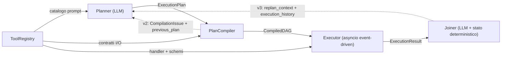
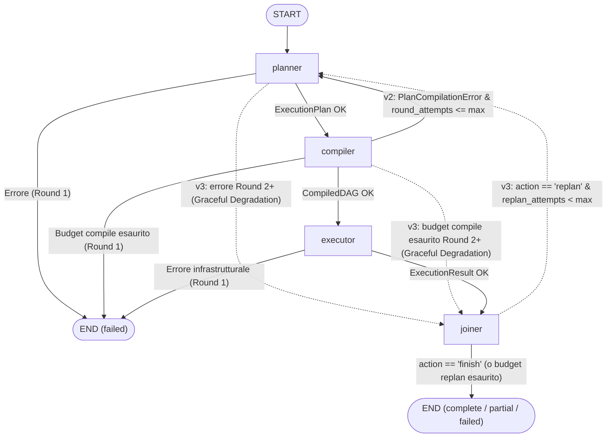

# langgraph-llm-compiler

Implementazione modulare, verificata formalmente e benchmarkabile dell'architettura **LLM Compiler** con orchestrazione stateful tramite **LangGraph** e supporto a modelli locali via **Ollama** (testata end-to-end con `qwen3:8b`).

Il progetto è progettato con tre obiettivi primari: **correttezza formale** (contratti di input/output validati staticamente e a runtime), **riproducibilità** (suite di test unitari deterministiche e benchmark salvati in JSON) e **valutazione sperimentale comparativa** (latenza, parallelismo effettivo, speedup misurato rispetto a baseline sequenziali, affidabilità e confronti tra motori di scheduling e configurazioni LLM).

---

## Indice

1. [Cos'è un LLM Compiler e quale problema risolve](#1-cosè-un-llm-compiler-e-quale-problema-risolve)
2. [Architettura completa e passaggio di testimone tra moduli indipendenti](#2-architettura-completa-e-passaggio-di-testimone-tra-moduli-indipendenti)
   - [2.1 Modulo 0 — `ToolRegistry` (il catalogo e i contratti)](#21-modulo-0--toolregistry-il-catalogo-e-i-contratti)
   - [2.2 Modulo 1 — `Planner` (dal testo libero al piano strutturato)](#22-modulo-1--planner-dal-testo-libero-al-piano-strutturato)
   - [2.3 Modulo 2 — `PlanCompiler` (dal piano non fidato al `CompiledDAG` certificato)](#23-modulo-2--plancompiler-dal-piano-non-fidato-al-compileddag-certificato)
   - [2.4 Modulo 3 — `Executor` (dal `CompiledDAG` all'esecuzione parallela)](#24-modulo-3--executor-dal-compileddag-allesecuzione-parallela)
   - [2.5 Modulo 4 — `Joiner` (dai risultati tecnici alla risposta finale)](#25-modulo-4--joiner-dai-risultati-tecnici-alla-risposta-finale)
   - [2.6 Modulo 5 — `graph` / LangGraph (il coordinatore sopra ai moduli)](#26-modulo-5--graph--langgraph-il-coordinatore-sopra-ai-moduli)
3. [Scelte architetturali e funzionamento interno (in dettaglio)](#3-scelte-architetturali-e-funzionamento-interno-in-dettaglio)
   - [3.1 Schema unificato `inputs` e dipendenze implicite (Strada A)](#31-schema-unificato-inputs-e-dipendenze-implicite-strada-a)
   - [3.2 `ToolRegistry` come unica *source of truth*](#32-toolregistry-come-unica-source-of-truth)
   - [3.3 Validazione sintattica (Pydantic) vs semantica (`PlanCompiler`) e algoritmo di Kahn](#33-validazione-sintattica-pydantic-vs-semantica-plancompiler-e-algoritmo-di-kahn)
   - [3.4 Scheduler `asyncio` event-driven vs LangGraph `StateGraph` dinamico (Pregel BSP)](#34-scheduler-asyncio-event-driven-vs-langgraph-stategraph-dinamico-pregel-bsp)
   - [3.5 Esecuzione best-effort, propagazione `SKIPPED` e telemetria serializzabile](#35-esecuzione-best-effort-propagazione-skipped-e-telemetria-serializzabile)
   - [3.6 Separazione deterministica nel `Joiner` (`JoinerOutput` / `JoinerDecisionOutput` vs `JoinerResult`)](#36-separazione-deterministica-nel-joiner-joineroutput--joinerdecisionoutput-vs-joinerresult)
   - [3.7 Orchestrazione macro con LangGraph: v1 lineare, v2 compile-time self-correction e v3 runtime replanning](#37-orchestrazione-macro-con-langgraph-v1-lineare-v2-compile-time-self-correction-e-v3-runtime-replanning)
   - [3.8 Rigore metodologico delle metriche](#38-rigore-metodologico-delle-metriche)
4. [Risultati sperimentali e analisi critica](#4-risultati-sperimentali-e-analisi-critica)
   - [4.1 Overhead puro di orchestrazione LangGraph](#41-overhead-puro-di-orchestrazione-langgraph)
   - [4.2 Baseline v1 su suite standard (4 tool, 8 query)](#42-baseline-v1-su-suite-standard-4-tool-8-query)
   - [4.3 Benchmark deterministico di scheduling (Event-driven vs Pregel BSP)](#43-benchmark-deterministico-di-scheduling-event-driven-vs-pregel-bsp)
   - [4.4 Hard Suite 10 tool: matrice 2x2 (v1 vs v2 e reasoning)](#44-hard-suite-10-tool-matrice-2x2-v1-vs-v2-e-reasoning)
   - [4.5 Cosa cambia con i retry (v2): vantaggi, svantaggi e guida alla scelta](#45-cosa-cambia-con-i-retry-v2-vantaggi-svantaggi-e-guida-alla-scelta)
   - [4.6 Runtime Replanning (v2 vs v3): fallback, alias, scoperta 2-stage e controllo anti-spreco](#46-runtime-replanning-v2-vs-v3-fallback-alias-scoperta-2-stage-e-controllo-anti-spreco)
   - [4.7 Confronto cross-architettura: LLM Compiler v3 vs LangGraph ReAct](#47-confronto-cross-architettura-llm-compiler-v3-vs-langgraph-react)
5. [Struttura del repository](#5-struttura-del-repository)
6. [Setup, verifica e comandi per gli esperimenti](#6-setup-verifica-e-comandi-per-gli-esperimenti)
7. [Roadmap](#7-roadmap)

---

## 1. Cos'è un LLM Compiler e quale problema risolve

Negli agenti tradizionali basati su tool-calling iterativo (come **ReAct**), il modello linguistico (LLM) procede un passo alla volta in un ciclo sequenziale:

$$\text{LLM (Ragionamento)} \rightarrow \text{Tool 1} \rightarrow \text{LLM (Osservazione)} \rightarrow \text{Tool 2} \rightarrow \text{LLM} \rightarrow \dots \rightarrow \text{Risposta}$$

Questo approccio presenta tre colli di bottiglia strutturali quando una richiesta richiede più strumenti (API, database, calcoli concatenati):

1. **Latenza moltiplicata dalle chiamate LLM**: per eseguire $N$ tool dipendenti o indipendenti servono fino a $N+1$ round-trip verso l'LLM, che è quasi sempre il componente più lento della pipeline.
2. **Nessun parallelismo naturale sui flussi complessi**: anche se la richiesta chiede dati su 4 Paesi diversi e poi 4 calcoli derivati, un agente iterativo spesso li esegue in serie (o in piccoli batch rigidi) senza un vero grafo delle dipendenze dati.
3. **Nessuna verifica statica prima dell'esecuzione**: se un parametro o un nome di tool è sbagliato al passo 4, l'errore emerge solo *dopo* aver già pagato il costo e la latenza dei passi 1, 2 e 3.

L'architettura **LLM Compiler** (ispirata a *An LLM Compiler for Parallel Function Calling*, Kim et al., 2024) risolve questi limiti separando **pianificazione**, **verifica formale**, **esecuzione parallela** e **sintesi**:

* Il **Planner** (1 chiamata LLM) traduce la richiesta in un **ExecutionPlan** completo: un grafo aciclico diretto (**DAG**, *Directed Acyclic Graph*) in cui ogni nodo è una chiamata a un tool e ogni arco è un collegamento esplicito tra l'output di un task e l'input di un altro.
* Il **PlanCompiler** (100% codice deterministico, < 1 ms) valida staticamente l'intero piano *prima* di chiamare qualsiasi strumento: verifica che tutti i tool esistano, che gli argomenti rispettino i contratti Pydantic, che non ci siano cicli e che tutti i percorsi nei dati di output siano validi. Se trova errori, in **v2** li restituisce strutturati al Planner per una correzione mirata (*compile-time self-correction*).
* L'**Executor** (motore asincrono `asyncio` event-driven) lancia in parallelo tutti i task privi di dipendenze e avvia automaticamente ogni task successivo nel millisecondo esatto in cui tutti i suoi prerequisiti sono pronti.
* Il **Joiner** (1 chiamata LLM + logica deterministica) sintetizza una risposta chiara nella lingua dell'utente basandosi esclusivamente sugli output riusciti, affiancandola a uno stato formale (`complete` / `partial` / `failed`) calcolato dal codice.

Nel caso felice, anche un workflow con 10–15 chiamate a strumenti viene risolto con **sole 2 chiamate LLM totali** (Planner + Joiner) e la massima parallelizzazione possibile dei tool.

> **In parole semplici:**
> Immagina di dover cucinare una cena con più portate. Un agente tradizionale (tipo ReAct) è come un cuoco che legge una riga della ricetta, esce a comprare il primo ingrediente, torna a casa, rilegge la ricetta, riesce a comprare il secondo ingrediente, mette a bollire l'acqua, aspetta che la pasta sia cotta *prima* ancora di iniziare a tagliare le verdure per il sugo.
>
> Un **LLM Compiler**, invece, si comporta come uno chef organizzato con una brigata:
> 1. Legge tutta la richiesta e scrive subito il **piano completo della cena** (cosa serve e in che ordine).
> 2. Prima di accendere i fornelli, un **ispettore** controlla la lista: verifica che tutti gli attrezzi esistano in cucina e che non ci siano errori logici.
> 3. La **squadra ai fornelli** fa partire subito in parallelo tutto ciò che non dipende da altro (acqua sul fuoco e taglio verdure contemporaneamente), e passa subito al passo successivo appena un ingrediente è pronto.
> 4. Alla fine, il **capo sala** porta il piatto in tavola spiegando chiaramente il risultato (e dicendo onestamente se un ingrediente non era disponibile).

---

## 2. Architettura completa e passaggio di testimone tra moduli indipendenti

Una delle scelte progettuali più importanti di questo repository è che **ogni modulo è completamente separato e autosufficiente**: ognuno ha un solo compito, un contratto di input/output tipizzato, una propria suite di test unitari dedicata e **non conosce i dettagli interni degli altri moduli**.

Puoi usare `Planner` da solo per generare piani, `PlanCompiler` da solo per validare un piano scritto a mano, `Executor` da solo su un `CompiledDAG` senza nessun LLM e senza LangGraph, o collegarli tutti tramite il modulo `graph`.



### Riepilogo dei moduli

| Modulo | File principali | Usa LLM? | Stato | Responsabilità unica |
| :--- | :--- | :---: | :---: | :--- |
| `ToolRegistry` (`compiler/registry.py`) | `registry.py` | No | Implementato | Custodisce i `ToolSpec` (funzioni + schemi Pydantic I/O) e genera il catalogo per il Planner. |
| `planner` | `schemas.py`, `planner.py` | **Sì** | Implementato (v3) | Trasforma la richiesta testuale (con eventuale `feedback` v2 e/o `replan_context` v3) in un `ExecutionPlan` sintatticamente valido. |
| `compiler` | `dag.py`, `compiler.py` | No | Implementato | Verifica staticamente tutte le regole semantiche del piano e produce un `CompiledDAG` immutabile (o tutte le `CompilationIssue`). |
| `executor` | `results.py`, `bindings.py`, `executor.py` | No | Implementato | Esegue il `CompiledDAG` in parallelo con scheduler `asyncio` event-driven e produce `ExecutionResult`. |
| `joiner` | `schemas.py`, `joiner.py` | **Sì** + codice | Implementato (v3) | Sintetizza `answer` (`finish`) oppure chiede un follow-up (`replan` con `replan_reason`), calcolando deterministicamente `status` e `missing_information` (`JoinerResult`). |
| `graph` | `state.py`, `nodes.py`, `builder.py` | No (orchestrazione) | Implementato (v3) | Collega i moduli in uno `StateGraph` LangGraph con compile retry v2 (`compiler -> planner`), runtime replan v3 (`joiner -> planner`) e degradazione controllata. |

---

Per vedere **esattamente** cosa fa ogni modulo, cosa riceve, cosa produce, quali garanzie offre e **dove finisce la sua responsabilità**, seguiamo lo stesso identico esempio reale dall'inizio alla fine (scenario `partial_failure_recovery`):

> **Richiesta utente:** *"Fetch statistics for Italy and Atlantis. Compute Italy's population density (population divided by area_km2) and compute the difference between Italy's population and Atlantis's population (Italy minus Atlantis)."*

---

### 2.1 Modulo 0 — `ToolRegistry` (il catalogo e i contratti)

Prima ancora che arrivi la richiesta, il sistema ha bisogno di sapere quali strumenti esistono. Questo è l'unico compito di `ToolRegistry` (`compiler/registry.py`).

* **Input:** un elenco di `ToolSpec`, ciascuno composto da nome, descrizione, funzione Python (`def` o `async def`), `input_schema` (Pydantic) e `output_schema` (Pydantic):
  ```python
  registry = ToolRegistry([
      ToolSpec(
          name="country_stats",
          description="Fetch demographic and economic statistics for a country.",
          func=get_country_stats,
          input_schema=CountryStatsInput,    # country: str
          output_schema=CountryStatsOutput,  # population: int, area_km2: float, ...
      ),
      ToolSpec(
          name="calculator",
          description="Perform basic arithmetic operations.",
          func=run_calculator,
          input_schema=CalculatorInput,      # operation: Literal['add','subtract','multiply','divide'], a: float, b: float
          output_schema=CalculatorOutput,    # result: float
      ),
  ])
  ```
* **Cosa fa:** registra i tool vietando duplicati involontari, verifica che gli schemi siano davvero sottoclassi di `BaseModel` e che gli handler siano `callable`. Su richiesta, genera automaticamente la descrizione testuale per il prompt (`registry.to_planner_catalog()`).
* **Output (due viste degli stessi dati):**
  1. **Verso il `Planner` (`dict[str, str]`):**
     ```text
     country_stats: Fetch demographic and economic statistics for a country.
       Args: country (str).
       Output: {"population": int, "area_km2": float, "gdp_billion_usd": float, "unemployment_pct": float}.
     calculator: Perform basic arithmetic operations.
       Args: operation ('add' | 'subtract' | 'multiply' | 'divide'), a (float), b (float).
       Output: {"result": float}.
     ```
  2. **Verso `PlanCompiler` ed `Executor`:** lookup diretto dei `ToolSpec` con i modelli Pydantic originali e le funzioni eseguibili.
* **Garanzie offerte a valle:**
  * Nomi univoci e non vuoti, handler eseguibili, schemi I/O coerenti e condivisi da tutti i moduli senza duplicazioni.
* **Fine della responsabilità:** `ToolRegistry` **non chiama mai** l'LLM, **non valida** piani e **non esegue** alcuna funzione. Espone i contratti e passa il testimone al **`Planner`**.

> **In parole semplici:**
> Il `ToolRegistry` è la cassetta degli attrezzi con l'etichetta attaccata su ogni strumento: *"questo è il cacciavite, serve per questo, accetta questi pezzi e produce questo risultato"*. Non fa lavori e non decide nulla: si limita a mostrare il catalogo ufficiale a chi dovrà pianificare, controllare o eseguire.

---

### 2.2 Modulo 1 — `Planner` (dal testo libero al piano strutturato)

Ora entra in scena il `Planner` (`planner/planner.py`). È il **primo modulo che usa un LLM**.

* **Input:**
  * `request: str` (la frase in linguaggio naturale dell'utente);
  * `tool_catalog: dict[str, str]` (prodotto da `ToolRegistry.to_planner_catalog()`);
  * *(solo nei retry v2)* `previous_plan: ExecutionPlan` e `feedback: str` con gli errori segnalati dal compilatore.
* **Cosa fa:** costruisce il prompt di sistema (con le regole del formato e 3 esempi astratti) + la richiesta utente, e chiama l'LLM con `with_structured_output(ExecutionPlan, method="json_schema", include_raw=True)`.
* **Output:** un oggetto Pydantic gerarchico `ExecutionPlan` immutabile:
  ```json
  {
    "objective": "Compute Italy's population density and population difference between Italy and Atlantis",
    "tasks": [
      {
        "task_id": "task_1",
        "tool_name": "country_stats",
        "description": "Get stats for Italy",
        "inputs": {"country": "Italy"}
      },
      {
        "task_id": "task_2",
        "tool_name": "country_stats",
        "description": "Get stats for Atlantis",
        "inputs": {"country": "Atlantis"}
      },
      {
        "task_id": "task_3",
        "tool_name": "calculator",
        "description": "Compute Italy's population density",
        "inputs": {
          "operation": "divide",
          "a": {"task_id": "task_1", "output_path": "population"},
          "b": {"task_id": "task_1", "output_path": "area_km2"}
        }
      },
      {
        "task_id": "task_4",
        "tool_name": "calculator",
        "description": "Calculate population difference (Italy - Atlantis)",
        "inputs": {
          "operation": "subtract",
          "a": {"task_id": "task_1", "output_path": "population"},
          "b": {"task_id": "task_2", "output_path": "population"}
        }
      }
    ]
  }
  ```
* **Garanzie offerte a valle:**
  * **Solo garanzie sintattiche/strutturali** (fornite da Pydantic): il risultato è un `ExecutionPlan` ben formato, immutabile (`frozen=True`), con `objective` e `tasks` non vuoti, nessun campo extra sconosciuto, e i binding ben formati già convertiti in oggetti `InputBinding(task_id, output_path)`.
  * Se l'LLM produce JSON rotto o fuori schema, il modulo solleva `PlannerOutputError` allegando `raw_output`.
* **Fine della responsabilità:** il `Planner` **non garantisce** che i `tool_name` esistano davvero, che gli argomenti siano del tipo giusto, che gli `output_path` esistano o che non ci siano cicli tra task. Ha tradotto l'intenzione umana in una proposta di piano strutturata: la sua responsabilità finisce qui e passa il testimone al **`PlanCompiler`**.

> **In parole semplici:**
> Il `Planner` è l'architetto che ascolta cosa vuoi costruire e disegna la bozza del progetto su carta millimetrata: *"passo 1 fai questo, passo 2 fai quest'altro, passo 3 prendi il risultato del passo 1 e dividilo..."*. Garantisce che il disegno sia leggibile e segua il formato standard del foglio, ma **non** è suo compito verificare con il righello se tutte le misure tornano: quello tocca all'ispettore successivo.

---

### 2.3 Modulo 2 — `PlanCompiler` (dal piano non fidato al `CompiledDAG` certificato)

Il `PlanCompiler` (`compiler/compiler.py`) riceve la proposta del `Planner` come **input non fidato** e la sottopone a verifica formale. È **100% deterministico (zero LLM, < 1 ms)**.

* **Input:**
  * `plan: ExecutionPlan` (prodotto dal `Planner`);
  * `registry: ToolRegistry` (per confrontare ogni task con i contratti ufficiali).
* **Cosa fa:** esegue in **un'unica passata** tutte le verifiche semantiche (`duplicate_task_id`, `unknown_tool`, `malformed_binding`, `self_dependency`, `missing_dependency`, `cycle_detected`, validazione statica di `input_schema` e attraversamento di `output_path` su `output_schema`). Se trova anche una sola violazione, solleva `PlanCompilationError` con l'elenco completo di tutte le `CompilationIssue`. Altrimenti applica l'**algoritmo di Kahn** per calcolare ordine topologico e livelli paralleli.
* **Output:** un `CompiledDAG` read-only (`frozen=True` + `MappingProxyType`):
  ```text
  CompiledDAG (valido, immutabile, 0.27 ms):
    nodes             : task_1, task_2, task_3, task_4
    root_tasks        : ('task_1', 'task_2')
    leaf_tasks        : ('task_3', 'task_4')
    topological_order : ('task_1', 'task_2', 'task_3', 'task_4')
    levels (ASAP)     :
      L0 │ [task_1: country_stats]  [task_2: country_stats]
      L1 │ [task_3: calculator]     [task_4: calculator]
    dependencies      :
      task_3 <- {task_1}   (task_1.population -> a, task_1.area_km2 -> b)
      task_4 <- {task_1, task_2}  (task_1.population -> a, task_2.population -> b)
  ```
* **Garanzie offerte a valle:**
  * **Garanzie semantiche e topologiche complete**: ogni `task_id` è univoco; ogni `tool_name` esiste nel `ToolRegistry`; ogni `InputBinding` punta a un task esistente e a un `output_path` realmente presente nello schema di output upstream; il grafo è garantito **aciclico**; tutti gli argomenti statici rispettano tipi, obbligatorietà ed enum di `input_schema`.
* **Fine della responsabilità:** il `PlanCompiler` **non esegue alcun tool**, **non fa I/O** e **non sa** se un dato esisterà a runtime (ad esempio `"Atlantis"` è una `str` sintatticamente e staticamente valida, quindi il piano è corretto: sarà il tool a scoprire a runtime che Atlantide non è nel database). La sua responsabilità finisce qui e passa il testimone all'**`Executor`**.

> **In parole semplici:**
> Il `PlanCompiler` è l'ingegnere collaudatore: prende la bozza dell'architetto, controlla ogni singola misura con il catalogo degli attrezzi e verifica che non ci siano circoli viziosi (*"A aspetta B che aspetta A"*). Se c'è anche un solo errore, boccia il piano spiegando esattamente cosa sistemare; se è tutto in regola, mette il timbro "approvato e sigillato" (`CompiledDAG`) e lo passa alla squadra operativa.

---

### 2.4 Modulo 3 — `Executor` (dal `CompiledDAG` all'esecuzione parallela)

L'`Executor` (`executor/executor.py`) riceve un `CompiledDAG` già certificato e lo esegue realmente. È **100% deterministico/asincrono (zero LLM, zero dipendenza da LangGraph)**.

* **Input:**
  * `dag: CompiledDAG` (prodotto dal `PlanCompiler`);
  * `registry: ToolRegistry` (per invocare gli handler e validare I/O a runtime);
  * configurazione di esecuzione: `max_concurrency` (default `8`), `task_timeout_s` (opzionale).
* **Cosa fa:** avvia in parallelo i `root_tasks` tramite `asyncio` (`ready_queue` + `asyncio.wait(..., FIRST_COMPLETED)`). Per ogni task pronto: risolve gli `InputBinding` leggendo i campi reali dagli output upstream (`resolve_task_inputs`), valida gli input risolti con `input_schema`, invoca il tool (`await` o `asyncio.to_thread`), valida il risultato con `output_schema`. Se un task fallisce, isola il guasto e marca immediatamente `skipped` tutti i suoi discendenti, lasciando correre i rami indipendenti.
* **Output:** un `ExecutionResult` immutabile e serializzabile in JSON, con telemetria per ogni singolo task:
  ```text
  ExecutionResult (wall: 141.8 ms | sum_task_duration: 192.3 ms | effective_parallelism: 1.36x):
    task_1 (country_stats) -> status="success" |   0 → 101 ms
      output = {"population": 58990000, "area_km2": 301340.0, "gdp_billion_usd": 2300.0, ...}
    task_2 (country_stats) -> status="error"   |   0 →  50 ms
      error_stage="tool_execution", error_type="ValueError",
      error="Country 'Atlantis' not found in dataset."
    task_3 (calculator)    -> status="success" | 101 → 142 ms
      output = {"result": 195.758943...}
    task_4 (calculator)    -> status="skipped" | started_at_ms=None, finished_at_ms=None
      skip_reason="Skipped because upstream task 'task_2' failed."
  ```
* **Garanzie offerte a valle:**
  * Ogni task del DAG ha esattamente un `TaskExecutionResult` con stato conclusivo (`success` / `error` / `skipped`), nessuna eccezione non gestita propaga all'esterno e nessun oggetto `Exception` raw inquina i dati.
  * Nessun task `success` ha violato il proprio `input_schema` o `output_schema`; nessun task dipendente da un nodo fallito è stato eseguito con dati corrotti.
* **Fine della responsabilità:** l'`Executor` **non sa** quale fosse la richiesta originale dell'utente, **non scrive** testo in linguaggio naturale e **non decide** come spiegare i risultati all'umano. La sua responsabilità finisce qui e passa il testimone al **`Joiner`**.

> **In parole semplici:**
> L'`Executor` è la squadra operativa sul campo: prende il progetto approvato e mette subito al lavoro tutti gli operai che possono partire contemporaneamente (`task_1` sull'Italia e `task_2` su Atlantide). Quando l'operaio su Atlantide scopre che il Paese non esiste, la squadra non ferma il cantiere: finisce comunque il calcolo sull'Italia (`task_3`), depenna il calcolo impossibile su Atlantide (`task_4`) e compila il registro di cantiere con risultati, errori e cronometro.

---

### 2.5 Modulo 4 — `Joiner` (dai risultati tecnici alla risposta finale)

Il `Joiner` (`joiner/joiner.py`) trasforma i dati tecnici grezzi dell'`Executor` nella risposta finale per l'utente. Combina **codice deterministico** (per lo stato formale) e **un LLM** (solo per la redazione testuale).

* **Input:**
  * `request: str` (la richiesta originale dell'utente, necessaria per la lingua e il contesto);
  * `execution_result: ExecutionResult` (prodotto dall'`Executor`);
  * `plan: ExecutionPlan | None` (opzionale, per usare le descrizioni umane `task.description` al posto dei nomi grezzi dei tool).
* **Cosa fa:**
  1. **Parte deterministica:** calcola `status` (`"complete"` / `"partial"` / `"failed"`) e costruisce `missing_information` ordinato topologicamente.
  2. **Parte LLM (LLM #2):** invoca l'LLM con `with_structured_output(JoinerOutput)` chiedendogli *soltanto* `answer: str`, ancorato ai soli task `success`, nella lingua della richiesta e senza esporre ID interni come `task_3`.
* **Output:** un oggetto `JoinerResult` immutabile:
  ```json
  {
    "status": "partial",
    "missing_information": [
      "Get stats for Atlantis — error (ValueError): Country 'Atlantis' not found in dataset.",
      "Calculate population difference (Italy - Atlantis) — skipped: Skipped because upstream task 'task_2' failed."
    ],
    "answer": "The population density of Italy is approximately 195.76 people per square kilometer. However, the population difference between Italy and Atlantis could not be calculated because statistics for Atlantis were not found in the dataset."
  }
  ```
* **Garanzie offerte a valle:**
  * `status` e `missing_information` sono **matematicamente coerenti** con `ExecutionResult` (non dipendono mai dall'umore dell'LLM);
  * `answer` è una stringa non vuota formattata per l'utente finale.
* **Fine della responsabilità:** quando `allow_replan=False` (o su errori irrecuperabili come `"Atlantis"`), il `Joiner` termina con `action="finish"` consegnando la risposta finale. Quando `allow_replan=True` e rileva un errore recuperabile (es. un tool di backup disponibile) o uno stadio di scoperta incompleto, restituisce `action="replan"` con `replan_reason` — senza mai modificare direttamente il piano né invocare tool: passa il testimone al coordinatore (`graph`) per un nuovo giro al `Planner`.

> **In parole semplici:**
> Il `Joiner` è il portavoce (e in v3 anche il revisore finale): legge il registro tecnico del cantiere e, se manca un pezzo che si può davvero recuperare con un attrezzo di riserva, chiede un giro extra mirato; se invece tutto è pronto o un pezzo è davvero irrecuperabile (come Atlantide), scrive subito un messaggio chiaro, educato e onesto nella tua lingua, con il timbro ufficiale *"completo / parziale / fallito"* calcolato automaticamente dal computer.

---

### 2.6 Modulo 5 — `graph` / LangGraph (il coordinatore sopra ai moduli)

Infine, il modulo `graph` (`graph/state.py`, `graph/nodes.py`, `graph/builder.py`) **non re-implementa nessuna logica** dei moduli precedenti: li avvolge in 4 nodi sottili dentro uno `StateGraph` di LangGraph.

* **Input:** lo stato iniziale `{"request": "..."}` passato a `await graph.ainvoke(...)` o `graph.astream(...)`.
* **Cosa fa:** gestisce il passaggio di stato (`CompilerState`) da un modulo all'altro, cronometra ogni fase in `WorkflowMetrics`, intercetta eventuali errori applicativi in `WorkflowError` e governa entrambi i cicli di controllo:
  * **v2 (`max_compile_retries > 0`)**: ciclo `compiler -> planner` quando `PlanCompiler` boccia un piano;
  * **v3 (`max_replans > 0`)**: ciclo `joiner -> planner` quando `Joiner` chiede un replan runtime, archiviando ogni round in `execution_history` e applicando *Graceful Degradation* se un round di replan fallisce prima dell'esecuzione.
* **Output:** lo stato finale `CompilerState` completo di:
  * `plan`, `compiled_dag`, `execution_result`, `execution_history`, `joiner_result`, `final_answer`, `status`;
  * `error` (eventuale `WorkflowError` fatale), `replan_error` (eventuale guasto non fatale di un round di replan recuperato via fallback), `compile_error_history`;
  * `metrics` (`planning_latency_ms`, `compilation_latency_ms`, `execution_latency_ms`, `joining_latency_ms`, `llm_calls`, `compile_attempts`, `compile_retries`, `replan_attempts`, `plan_valid`, `component_latency_ms`).
* **Garanzie offerte a valle:**
  * Terminazione garantita (grazie ai budget separati `max_compile_retries` per round e `max_replans` globale), proprietà di sicurezza monotonica (un replan fallito non distrugge mai risultati già ottenuti al Round 1), osservabilità step-by-step via `astream`, e separazione netta tra logica dei componenti e orchestrazione del flusso.

> **In parole semplici:**
> Il modulo `graph` è il **nastro trasportatore intelligente** (con un supervisore) che collega le postazioni di lavoro descritte sopra: prende la scatola prodotta da un reparto, cronometra quanto ci ha messo, la passa al reparto successivo e gestisce sia i ritorni dell'ispettore (`PlanCompiler` → `Planner`, v2) sia i giri extra richiesti dal portavoce dopo aver visto i risultati reali (`Joiner` → `Planner`, v3). Se un giro extra dovesse andare storto, il supervisore non butta mai via il lavoro buono già fatto al primo giro. E se un giorno vuoi sostituire LangGraph con un altro orchestratore, tutti i moduli sotto (`ToolRegistry`, `Planner`, `PlanCompiler`, `Executor`, `Joiner`) continuano a funzionare esattamente allo stesso modo senza cambiare una riga.

---

## 3. Scelte architetturali e funzionamento interno (in dettaglio)

### 3.1 Schema unificato `inputs` e dipendenze implicite (Strada A)

In `src/langgraph_llm_compiler/planner/schemas.py`, ogni task è definito da `TaskSpec`:

* `task_id: NonEmptyStr`
* `tool_name: NonEmptyStr`
* `description: NonEmptyStr`
* `inputs: dict[str, TaskInputValue]` dove:
  ```python
  class InputBinding(BaseModel):
      model_config = ConfigDict(frozen=True, extra="forbid")
      task_id: NonEmptyStr
      output_path: NonEmptyStr

  TaskInputValue = Annotated[InputBinding | Any, Field(union_mode="left_to_right")]
  ```

Tutti i modelli hanno `frozen=True` (immutabili) e `extra="forbid"` (rifiutano campi non previsti come i vecchi `arguments`, `input_bindings` o `dependencies`). Le proprietà derivate `task.static_inputs` e `task.bindings` filtrano automaticamente `inputs` separando i valori statici dagli `InputBinding`.

**Perché questa scelta ("Strada A") è stata decisiva:**
1. **Zero divergenze tra dipendenze e dataflow**: il grafo delle dipendenze è derivato *unicamente* dai `task_id` presenti in `task.bindings`. Non esiste un campo `dependencies` separato che l'LLM potrebbe dimenticare di aggiornare o tenere disallineato.
2. **Eliminazione per costruzione delle collisioni di chiavi**: in una versione preliminare con dizionari separati (`arguments` per valori statici + `input_bindings` per riferimenti dinamici), `qwen3:8b` inseriva spesso valori segnaposto come `"a": 0` in `arguments` *mentre* dichiarava `"a": {"task_id": "task_1", ...}` in `input_bindings`, provocando errori di collisione in circa 2/3 dei DAG complessi. Con un **singolo dizionario `inputs`** una chiave può contenere *o* un valore statico *o* un `InputBinding`: la collisione è matematicamente impossibile.
3. **Precedenza esplicita `union_mode="left_to_right"`**: Pydantic prova *prima* a validare qualsiasi valore come `InputBinding`; solo se non corrisponde ricade in `Any` (valore statico).
4. **Prompt neutro anti-overfitting (`planner/planner.py`)**: gli esempi nel `SYSTEM_PROMPT` usano esclusivamente nomi di tool fittizi e astratti (`fetch_record`, `compare_values`, `scale_value`). Nei test preliminari su `qwen3:8b`, inserire il nome reale `"calculator"` in un esempio few-shot induceva il modello a copiare letteralmente argomenti dell'esempio (es. `"b": 1`) nelle chiamate reali a `calculator`. L'uso di tool astratti ha eliminato completamente questo bias.
5. **Structured output con debuggabilità**: il Planner invoca `llm.with_structured_output(ExecutionPlan, method="json_schema", include_raw=True)`. Se il modello emette JSON malformato o non conforme, `PlannerOutputError` conserva sempre `raw_output` per l'analisi post-mortem.

> **In parole semplici:**
> Prima avevamo tre fogli separati che l'intelligenza artificiale doveva compilare a mano: *"valori fissi"*, *"collegamenti ai passi precedenti"* e *"elenco delle dipendenze"*. Un modello piccolo (8 miliardi di parametri) faceva spesso confusione, scrivendo `0` sul primo foglio e il collegamento sul secondo, mandando in conflitto il sistema.
>
> Con lo **schema unificato `inputs`**, abbiamo messo tutto in un'unica tabella: per ogni parametro c'è una sola casella. O ci scrivi un numero/testo fisso (es. `"Italy"`), oppure ci metti una freccia (es. *"prendi `population` dal `task_1`"*). In questo modo è fisicamente impossibile contraddirsi, e il sistema capisce da solo chi dipende da chi semplicemente guardando le frecce.

---

### 3.2 `ToolRegistry` come unica *source of truth*

In `src/langgraph_llm_compiler/compiler/registry.py`, ogni strumento viene registrato una sola volta come `ToolSpec`:

```python
ToolSpec(
    name="country_stats",
    description="Fetch demographic and economic statistics for a country.",
    func=get_country_stats,
    input_schema=CountryStatsInput,
    output_schema=CountryStatsOutput,
)
```

Da questa singola registrazione derivano automaticamente tre usi sincronizzati:
1. **Prompt del Planner**: `ToolRegistry.to_planner_catalog()` serializza nomi, descrizioni, campi di input (con tipi, vincoli `Literal`/enum e obbligatorietà) e campi di output (inclusi eventuali campi annidati multi-livello) direttamente nel prompt.
2. **Validazione statica nel PlanCompiler**: gli stessi `input_schema` e `output_schema` vengono usati per verificare argomenti statici e `output_path` prima di eseguire alcunché.
3. **Validazione runtime nell'Executor**: prima e dopo l'esecuzione di ogni handler, l'Executor valida gli input risolti con `input_schema` e il valore di ritorno con `output_schema`.

> **In parole semplici:**
> Il `ToolRegistry` è come l'unico manuale ufficiale degli attrezzi del laboratorio. Sia chi pianifica il lavoro (Planner), sia chi lo controlla (Compiler), sia chi usa gli attrezzi (Executor) legge sempre la *stessa identica pagina*. Se cambi un parametro a uno strumento in un solo punto del codice, tutta la pipeline si aggiorna automaticamente senza rischiare discrepanze.

---

### 3.3 Validazione sintattica (Pydantic) vs semantica (`PlanCompiler`) e algoritmo di Kahn

La pipeline separa rigorosamente due classi di errori:
* **Errori sintattici (`PlannerOutputError`)**: controllati da Pydantic sul JSON prodotto dall'LLM (campi mancanti, stringhe vuote `NonEmptyStr`, campi extra proibiti, JSON troncato).
* **Errori semantici (`PlanCompilationError`)**: controllati da `PlanCompiler.compile(plan)` sull'intero grafo in **un'unica passata** (*non* fail-fast). Anziché interrompersi al primo errore, il compilatore raccoglie tutte le `CompilationIssue(code, message, task_id, field)` in un solo report completo, così nel loop v2 il Planner può correggere più problemi in un unico tentativo.

Le regole verificate in singola passata da `PlanCompiler` sono:

| Codice `CompilationIssue` | Cosa verifica |
| :--- | :--- |
| `duplicate_task_id` | Unicità di tutti i `task_id` nel piano. |
| `unknown_tool` | Esistenza di ogni `tool_name` nel `ToolRegistry`. |
| `malformed_binding` | Intercetta dizionari in `inputs` che contengono `"task_id"` ma hanno fallito il parsing `InputBinding` (es. refuso `'output, path'` o chiave inventata `'divided_by'`). Senza questo controllo specifico, il fallback `Any` della union produrrebbe un messaggio fuorviante come *"Input should be a valid number"*; il compilatore invece emette `malformed_binding` indicando esattamente le chiavi ammesse (`'task_id'`, `'output_path'`) e sopprime il falso positivo `invalid_static_argument`. |
| `self_dependency` | Divieto per un task di fare riferimento al proprio stesso `task_id`. |
| `missing_dependency` | Esistenza di ogni `task_id` referenziato da un `InputBinding`. |
| `cycle_detected` | Assenza di cicli nel grafo delle dipendenze, con ricostruzione esplicita del percorso del ciclo (es. `task_1 -> task_2 -> task_1`). |
| `missing_required_argument` / `unknown_argument` / `invalid_static_argument` | Validazione statica dei parametri contro `ToolSpec.input_schema` (verificando anche gli enum `Literal` e i tipi dei valori statici, pur ignorando momentaneamente i campi che arriveranno via binding a runtime). |
| `invalid_output_path` | Attraversamento ricorsivo del percorso punteggiato (es. `economy.gdp.nominal_billion_usd`) lungo la gerarchia di modelli Pydantic dell'`output_schema` del task upstream. |

Se non emerge alcuna issue, il compilatore esegue l'**algoritmo di Kahn** (ordinamento topologico con calcolo dei livelli *ASAP — As Soon As Possible*) e costruisce un `CompiledDAG` completamente **immutabile** (`frozen=True` + `MappingProxyType` per tutte le mappe interne) che espone:
* `topological_order`: sequenza deterministica dei task;
* `levels`: raggruppamento per profondità logica (utile per analisi e visualizzazione, *non* usato come barriera di esecuzione);
* `root_tasks` e `leaf_tasks`;
* `is_ready(task_id, completed_ids)`: predicato $O(\text{in-degree})$ usato dallo scheduler event-driven.

> **In parole semplici:**
> Immagina un insegnante molto preciso che corregge il tema prima di consegnarlo alla giuria. Invece di fermarsi al primo errore di ortografia e ridarti il foglio indietro dieci volte, legge *tutto* il piano dall'inizio alla fine e ti restituisce una lista numerata con ogni singolo problema: *"qui hai usato un attrezzo che non esiste, qui hai scritto un collegamento sbagliato, qui il passo 2 aspetta il passo 3 che aspetta il passo 2"*.
>
> In più, se il modello sbaglia a scrivere un collegamento (magari aggiungendo una parola inventata come `divided_by`), il compilatore riconosce che stava provando a fare un collegamento e glielo dice chiaramente invece di rispondergli *"mi aspettavo un numero"*. Solo quando il foglio non ha più neanche un segno rosso viene promosso a piano esecutivo immutabile (`CompiledDAG`).

---

### 3.4 Scheduler `asyncio` event-driven vs LangGraph `StateGraph` dinamico (Pregel BSP)

Una scelta architetturale fondamentale del progetto è mantenere l'`Executor` (`src/langgraph_llm_compiler/executor/executor.py`) **completamente indipendente da LangGraph**, eseguendo il `CompiledDAG` tramite uno scheduler **event-driven con ready-queue** in `asyncio`:

1. Tutti i `root_tasks` entrano subito nella `ready_queue`.
2. Finché ci sono task in `ready_queue` e slot liberi rispetto a `max_concurrency` (default `8`; `None` per concorrenza illimitata; `1` per ottenere una **baseline sequenziale equa** sullo stesso codice), lo scheduler avvia `asyncio.create_task(...)`.
3. Lo scheduler attende con `asyncio.wait(running, return_when=asyncio.FIRST_COMPLETED)`: **nel millisecondo esatto in cui termina anche un solo task**, ne controlla i soli successori diretti tramite `dag.is_ready(...)` e mette immediatamente in esecuzione quelli le cui dipendenze sono tutte soddisfatte.
4. **Supporto trasparente a tool sync e async**: le coroutine `async def` (rilevate con `inspect.iscoroutinefunction`) sono eseguite con `await`; le funzioni `def` sincrone vengono delegate a `asyncio.to_thread()` per non bloccare l'event loop.
5. **Timeout per task (`task_timeout_s`)**: su tool `async def`, `asyncio.wait_for` cancella effettivamente la coroutine; su tool `def` sincroni in `asyncio.to_thread`, interrompe l'attesa e registra `error_stage="timeout"` (nota tecnica Python: un thread OS già avviato non è terminabile forzatamente, quindi è buona norma usare tool `async def` o idempotenti quando si testano timeout stretti).

**Perché NON abbiamo trasformato il `CompiledDAG` in un `StateGraph` dinamico di LangGraph?**
Perché il runtime **Pregel** di LangGraph segue il modello **Bulk Synchronous Parallel (BSP)**: l'esecuzione avanza per *superstep* discreti separati da una **barriera di sincronizzazione globale**. Tutti i nodi lanciati nello stesso superstep devono completare prima che il superstep successivo possa iniziare. In presenza di tool/API con latenze diverse (caso normale nel mondo reale), un ramo veloce resta bloccato alla barriera ad aspettare un ramo lento completamente indipendente.

#### Verifica sperimentale: Event-driven vs LangGraph Pregel BSP (`benchmark_scheduling.py`)

Per misurare questa differenza in modo oggettivo (zero chiamate LLM, stessi identici `CompiledDAG` eseguiti su 3 motori, mediana su 3 ripetizioni; report completo in `results/benchmark_scheduling.json`):

| Topologia DAG | Nodi / Livelli | Sequenziale (`max=1`) | LangGraph Pregel BSP *(+compile)* | Executor Event-driven (`max=8`) | Speedup BSP | Speedup Event-driven | Riduzione latenza vs BSP |
| :--- | :---: | ---: | ---: | ---: | :---: | :---: | :---: |
| `symmetric_fanout` *(controllo equità)* | 5 / 2 | 522.2 ms | 164.4 ms *(+2.8 ms)* | **160.9 ms** | 3.18x | **3.25x** | -2.1% *(parità)* |
| `asymmetric_branches` *(T1:50→T3:250 vs T2:300→T4:50 → T5:50)* | 5 / 3 | 702.5 ms | 606.1 ms *(+3.0 ms)* | **401.8 ms** | 1.16x | **1.75x** | **-33.7%** (-204 ms) |
| `staggered_multi_branch` *(profilo reale di `test2`)* | 8 / 3 | 903.7 ms | 466.4 ms *(+4.0 ms)* | **421.8 ms** | 1.94x | **2.14x** | **-9.6%** (-45 ms) |
| `deep_asymmetric_pipeline` *(4 livelli asimmetrici)* | 7 / 4 | 663.3 ms | 548.3 ms *(+3.8 ms)* | **383.0 ms** | 1.21x | **1.73x** | **-30.1%** (-165 ms) |

Il diagramma Gantt affiancato su `asymmetric_branches` (stessa scala temporale `0 → 606 ms`) mostra visivamente l'effetto della barriera BSP:

```text
LangGraph Pregel BSP (606 ms):
  T1 │██································│   1 →  52 ms
  T2 │████████████████··················│   1 → 302 ms
  T3 │·················██████████████···│ 304 → 555 ms  <-- fermo 252 ms alla barriera BSP!
  T4 │·················██···············│ 304 → 354 ms
  T5 │·······························██·│ 555 → 606 ms

Executor Event-driven (402 ms):
  T1 │██································│   0 →  50 ms
  T2 │████████████████··················│   0 → 301 ms
  T3 │··██████████████··················│  51 → 301 ms  <-- parte subito al termine di T1!
  T4 │················███···············│ 301 → 352 ms
  T5 │···················███············│ 352 → 402 ms
```

* Sul caso simmetrico (`symmetric_fanout`) i due motori pareggiano (`164.4 ms` vs `160.9 ms`), dimostrando che il benchmark è equo e non artificialmente sbilanciato.
* Sui DAG asimmetrici, eliminare la barriera BSP riduce il tempo di esecuzione fino al **-33.7%** (-204 ms su 606 ms) e risparmia anche ~3–4 ms di compilazione dinamica del grafo a ogni richiesta.

> **In parole semplici:**
> Immagina una staffetta con due corsie parallele. Nella corsia A il primo corridore è velocissimo (50 secondi) e il secondo è più lento (250 secondi); nella corsia B il primo è lento (300 secondi) e il secondo è veloce (50 secondi).
> * Nel modello a **"ondate" (Pregel BSP di LangGraph)**, il giudice di gara non lascia partire *nessun* secondo corridore finché *entrambi* i primi corridori non hanno finito. Così il secondo corridore della corsia A resta fermo ai blocchi per 250 secondi a guardare la corsia B!
> * Nel nostro modello **a eventi (Event-driven)**, appena il primo corridore della corsia A arriva al cambio, il suo compagno parte **all'istante** senza aspettare la corsia B. Risultato: la gara finisce in un terzo del tempo in meno!

---

### 3.5 Esecuzione best-effort, propagazione `SKIPPED` e telemetria serializzabile

In `src/langgraph_llm_compiler/executor/results.py` e `executor.py`, ogni task produce un `TaskExecutionResult` immutabile (`frozen=True`):

* `status`: `"success" | "error" | "skipped"`
* `output`: payload validato tramite `ToolSpec.output_schema` (solo se `success`)
* `error`, `error_type`, `error_stage`: compilati in caso di errore, con `error_stage` che distingue esattamente dove si è verificato il guasto:
  * `"binding"` (fallimento nella risoluzione di un `output_path` a runtime)
  * `"input_validation"` (i dati risolti a runtime violano `input_schema`, es. divisione per zero o tipi imprevisti)
  * `"tool_execution"` (eccezione lanciata dal tool stesso, es. risorsa non trovata)
  * `"output_validation"` (il tool ha restituito un dato non conforme a `output_schema`)
  * `"timeout"` (superato `task_timeout_s`)
* `skip_reason`: compilato se un task upstream è fallito
* `duration_ms`, `started_at_ms`, `finished_at_ms`: telemetria precisa (`None` per i timestamp dei task `skipped`, perché non sono mai stati avviati)

**Politica best-effort e propagazione transitiva:**
* Se un task fallisce, l'Executor **non interrompe** i rami indipendenti del DAG.
* Tutti i discendenti raggiungibili dal task fallito (diretti e indiretti, a qualsiasi profondità) vengono marcati immediatamente `status="skipped"` senza mai occupare slot di esecuzione.
* Nessun oggetto `Exception` raw viene conservato nei risultati: `ExecutionResult` è 100% serializzabile in JSON, rendendolo sicuro per lo stato di LangGraph, i log sperimentali e futuri checkpointer.

> **In parole semplici:**
> Se durante una giornata di commissioni scopri che la panetteria è chiusa, non annulli dal calendario anche la farmacia e la posta: porti a casa tutto ciò che non dipendeva dal pane (esecuzione *best-effort*), depenni automaticamente dalla lista "fare i panini" perché senza pane non si possono fare (propagazione *skipped*), e sul taccuino annoti l'ora esatta e il motivo preciso di ogni intoppo.

---

### 3.6 Separazione deterministica nel `Joiner` (`JoinerOutput` / `JoinerDecisionOutput` vs `JoinerResult`)

In `src/langgraph_llm_compiler/joiner/`, separiamo nettamente ciò che è **generativo** da ciò che è **deterministico**, usando un **doppio schema adattivo** per garantire zero overhead quando il replanning non è attivo:

* **Modalità sintesi (`allow_replan=False`, v1/v2 o ultimo giro del budget v3)**: l'LLM usa lo schema leggero `JoinerOutput(answer)` e genera *unicamente* il testo finale seguendo 4 regole:
  1. **Lingua**: rispondere nella stessa lingua della richiesta utente originale.
  2. **Grounding stretto**: riportare solo fatti e numeri presenti negli output `success` (su tutti i round eseguiti); mai inventare o stimare risultati mancanti.
  3. **Trasparenza**: esplicitare chiaramente quali parti non sono state completate e perché.
  4. **Stile user-friendly**: non esporre mai identificativi interni (`task_1`, `task_4`) né nomi grezzi di funzioni/tool nella risposta finale.
* **Modalità decisionale (`allow_replan=True`, v3 con budget residuo)**: l'LLM usa `JoinerDecisionOutput(action, answer, replan_reason)` (con binding lazy e normalizzazione automatica `"" -> None` contro le stringhe vuote tipiche dei modelli 8B) e riceve anche il `tool_catalog` ufficiale (`AVAILABLE TOOLS`) per prendere una decisione informata:
  * **`"replan"`**: scelto *solo* se (a) un errore runtime può essere recuperato tramite un tool alternativo nel catalogo o argomenti corretti, oppure (b) i task del Round 1 hanno scoperto dati intermedi necessari a lanciare il Round 2.
  * **`"finish"`**: scelto immediatamente se la richiesta è già soddisfatta oppure se l'errore è irrecuperabile (es. `"Atlantis"` non esiste in alcun tool), evitando replan sprecati.
* **Responsabilità del codice deterministico (`JoinerResult`)**:
  * `classify_execution_status(execution_result, prior_rounds)` calcola `status`:
    * `"complete"` se tutti i task dell'ultimo round sono `success`;
    * `"partial"` se l'ultimo round ha errori/skip ma almeno un task è riuscito in *qualsiasi* round;
    * `"failed"` se zero task sono riusciti su tutti i round.
  * `extract_missing_information(execution_result, plan)` costruisce l'elenco ordinato topologicamente dei task falliti o saltati, usando `task.description` (con fallback a `tool_name`).

> **In parole semplici:**
> All'intelligenza artificiale chiediamo solo ciò che sa fare bene: scrivere una risposta chiara nella tua lingua e, in v3, guardare l'elenco degli attrezzi disponibili per capire se vale la pena fare un secondo tentativo con uno strumento di riserva (invece di accanirsi inutilmente su qualcosa che non esiste). Il "semaforo" ufficiale (`complete` / `partial` / `failed`) e la lista esatta delle informazioni mancanti restano però sempre calcolati dal codice con matematica rigida, così il modello non può mai mentire sullo stato del lavoro.

---

### 3.7 Orchestrazione macro con LangGraph: v1 lineare, v2 compile-time self-correction e v3 runtime replanning

LangGraph viene usato **esclusivamente al livello di orchestrazione macro stateful** (`src/langgraph_llm_compiler/graph/`), dove brillano i suoi punti di forza: gestione pulita dei cicli di controllo tramite conditional edges, stato condiviso tipizzato (`CompilerState`), streaming passo-passo (`astream`) e interfaccia uniforme per confrontare la nostra architettura con altri agenti (es. ReAct).



Dettagli chiave dell'implementazione in `graph/state.py`, `graph/nodes.py` e `graph/builder.py`:

* **4 nodi async sottili (`nodes.py`)**: ciascun nodo wrappa il proprio componente core (`Planner`, `PlanCompiler`, `Executor`, `Joiner`) misurandone la latenza cumulativa via `time.perf_counter()`, aggiornando `WorkflowMetrics` e intercettando eccezioni applicative in `WorkflowError` (preservando però esplicitamente `asyncio.CancelledError`).
* **Progressione retrocompatibile `v1 -> v2 -> v3`**: `build_compiler_graph(..., max_compile_retries: int = 0, max_replans: int = 0)` espone solo gli archi necessari:
  * **`v1` (`0, 0`)**: grafo puramente lineare con uscite anticipate su errore.
  * **`v2` (`max_compile_retries > 0`)**: abilita il ciclo `compiler -> planner` su `PlanCompilationError`, passando `previous_plan` + `compile_feedback` e accumulando `compile_error_history`.
  * **`v3` (`max_replans > 0`)**: abilita il ciclo **Context-Injected Replanning** `joiner -> planner`:
    1. Prima di ripartire, il nodo `joiner` archivia il round concluso in `execution_history: list[ExecutionRound]` e costruisce `replan_context` tramite `format_replan_context(...)`, elencando risultati già ottenuti (come valori letterali, **omettendo deliberatamente i vecchi `task_id`** per impedire all'LLM di creare `InputBinding` rotti verso round precedenti) e chiamate fallite da non ripetere.
    2. `PlanCompiler` ed `Executor` restano **invariati al 100%**: validano ed eseguono un normale `CompiledDAG` pulito per i soli passi mancanti o di fallback.
    3. **Budget indipendenti e coesistenza v2 + v3**: ogni replan azzera `round_compile_attempts` (così il Round 2 ha un budget pieno di compile retry, mentre `metrics.compile_attempts` e `metrics.compile_retries` tengono i totali globali esatti); se il Round 2 sbaglia a compilare, il `Planner` riceve **sia** `replan_context` **sia** `previous_plan` + `compile_feedback`.
    4. **Graceful Degradation (proprietà di sicurezza monotonica)**: se un round di replan fallisce al `planner`, al `compiler` (budget esaurito) o all'`executor`, il router **non distrugge** i risultati già raccolti nel Round 1: devia sul `joiner` in modalità `allow_replan=False` sull'ultimo round riuscito in `execution_history`, consegnando comunque la miglior risposta parziale e registrando il guasto di replan in `replan_error` (lasciando `error = None`).
* **Nessun parametro fittizio (`checkpointer`)**: `build_compiler_graph` non espone ancora un parametro `checkpointer` perché la serializzazione di `CompiledDAG` (che usa `MappingProxyType`) tramite `MemorySaver`/`SqliteSaver` non è stata ancora testata formalmente; verrà introdotto solo insieme ai relativi test di persistenza.

> **In parole semplici:**
> LangGraph è il **direttore d'orchestra** che coordina i quattro reparti tenendo un quaderno di stato condiviso:
> * Nella **versione 1**, se qualcosa va storto lo spettacolo si ferma subito.
> * Nella **versione 2**, se l'Ispettore (`PlanCompiler`) trova errori *prima* di partire, rimanda la bozza al Pianificatore fino a 2 volte per farla correggere gratis prima di chiamare qualsiasi strumento.
> * Nella **versione 3**, anche *dopo* che la squadra ha lavorato sul campo, se uno strumento era rotto (e ce n'è uno di riserva) oppure se al primo giro abbiamo scoperto un elenco di nomi su cui bisogna ora lavorare, il direttore salva il lavoro buono già fatto, mostra al Pianificatore i numeri già trovati e lancia un **secondo giro mirato** solo per ciò che manca. E se per caso il secondo giro va storto, il direttore ha una rete di sicurezza: non butta mai via i risultati buoni del primo giro!

---

### 3.8 Rigore metodologico delle metriche

Nei benchmark di sistemi paralleli è facile confondere metriche simili ma concettualmente diverse. In questo progetto le separiamo in modo esplicito:

* **Effective parallelism** (calcolato in `ExecutionResult`):
  $$\text{effective\_parallelism} = \frac{\sum_{i} T_i}{T_{\text{parallel}}}$$
  Indica il grado medio di sovrapposizione dei task osservato durante una singola esecuzione (somma delle durate individuali divisa per il tempo wall-clock parallelo).
* **Measured speedup** (calcolato nei benchmark):
  $$\text{measured\_speedup} = \frac{T_{\text{sequential (max\_concurrency=1)}}}{T_{\text{parallel}}}$$
  È lo speedup *reale* misurato rieseguendo lo stesso identico `CompiledDAG` sullo stesso `Executor` con `max_concurrency=1` come baseline sequenziale, eliminando qualsiasi bias di implementazione.
* **Overhead puro di orchestrazione LangGraph**:
  $$\text{langgraph\_overhead\_ms} = T_{\text{graph\_wall}} - \text{metrics.component\_latency\_ms}$$
  Dove `component_latency_ms` è la somma esatta dei tempi spesi dentro i 4 nodi (`planning + compilation + execution + joining`). La differenza isola al centesimo di millisecondo il costo del runtime LangGraph (dispatch nodi, transizioni stato, routing condizionale).

> **In parole semplici:**
> Per essere scientificamente onesti, non ci accontentiamo di dire *"sembra veloce"*: cronometriamo sempre il **confronto diretto** tra fare lo stesso identico lavoro un passo alla volta (`max_concurrency=1`) e farlo in parallelo, e separiamo il tempo passato a lavorare davvero dal tempo speso dal "direttore d'orchestra" (LangGraph) per spostare le carte da una scrivania all'altra.

---

## 4. Risultati sperimentali e analisi critica

Tutti gli esperimenti live sono stati eseguiti localmente tramite **Ollama** con il modello **`qwen3:8b`** (`temperature=0.0`, `joiner reasoning=False`). Tutti i dataset di output completi in JSON sono archiviati in `results/`.

### 4.1 Overhead puro di orchestrazione LangGraph

Script: `experiments/test_graph_qwen3.py --mode overhead --overhead-iters 50`

Per isolare il costo di LangGraph dalla varianza non deterministica dell'LLM, abbiamo confrontato la chiamata diretta in Python dei 4 componenti contro `build_compiler_graph(...)` su **50 iterazioni deterministiche** (modelli fake e tool a 0 ms):

| Configurazione | Mediana | Media | Note |
| :--- | ---: | ---: | :--- |
| Pipeline diretta Python | `0.351 ms` | `0.368 ms` | 4 chiamate sequenziali dirette |
| LangGraph `StateGraph` (`graph_wall_time`) | `2.186 ms` | `2.230 ms` | Include dispatch nodi e gestione stato Pregel |
| **Overhead puro LangGraph** | **`+1.83 ms`** | **`+1.86 ms`** | Nei run live su `qwen3:8b`: `~3.8–4.1 ms` (`< 0.1%` del tempo totale) |

**Conclusione:** usare LangGraph come orchestratore macro aggiunge meno di 2 millisecondi a vuoto (~4 ms nei run live con payload completi) — completamente trascurabile rispetto ai secondi dell'LLM, a fronte di un enorme guadagno in osservabilità, streaming e gestione dei cicli v2/v3.

---

### 4.2 Baseline v1 su suite standard (4 tool, 8 query)

Script: `experiments/benchmark_v1_baseline.py --reasoning-modes both`
Report: `results/v1_baseline_20261119T192608Z.json`

La suite standard comprende 4 tool (`country_stats`, `calculator`, `percent_change`, `currency_convert`) e 8 query di difficoltà crescente (`easy`, `medium`, `hard`, `resilience` con fallimento parziale).

Prima del refactor allo schema unificato `inputs` (Strada A), `qwen3:8b` falliva circa 2/3 dei DAG complessi per collisioni tra `arguments` e `input_bindings`. Dopo Strada A, persino **v1 senza alcun retry (`max_compile_retries=0`)** raggiunge la saturazione completa (**16/16 = 100%**):

| Modalità Planner | Plan Valid | Status OK | Accuratezza Numerica | Med Plan | Med Join | Med Wall | Med Speedup (Max) | Med Overhead LG |
| :--- | :---: | :---: | :---: | ---: | ---: | ---: | :---: | ---: |
| `v1` + `reasoning=False` | **8/8 (100%)** | **8/8 (100%)** | **8/8 (100%)** | **3.44 s** | 0.65 s | **4.24 s** | 1.41x (**2.15x**) | `3.91 ms` |
| `v1` + `reasoning=True` | **8/8 (100%)** | **8/8 (100%)** | **8/8 (100%)** | 7.19 s | 0.62 s | 7.99 s | 1.41x (**2.14x**) | `3.85 ms` |

**Conclusione:** su cataloghi compatti (4 tool) e schemi chiari, lo schema unificato `inputs` rende `qwen3:8b` talmente affidabile da saturare la suite già al primo tentativo; in questo regime `reasoning=False` è strettamente preferibile perché dimezza la latenza (`4.24 s` vs `7.99 s`) a parità di accuratezza (100%).

---

### 4.3 Benchmark deterministico di scheduling (Event-driven vs Pregel BSP)

Script: `experiments/benchmark_scheduling.py --repeats 3` — Report: `results/benchmark_scheduling.json`

Come dettagliato nella [Sezione 3.4](#34-scheduler-asyncio-event-driven-vs-langgraph-stategraph-dinamico-pregel-bsp), a parità di `CompiledDAG` lo scheduler `asyncio` event-driven pareggia con LangGraph Pregel BSP sui DAG simmetrici (`160.9 ms` vs `164.4 ms`, -2.1%) e abbatte la latenza di esecuzione fino al **-33.7%** (`401.8 ms` vs `606.1 ms` su `asymmetric_branches`, **-30.1%** su `deep_asymmetric_pipeline`) sui DAG asimmetrici.

---

### 4.4 Hard Suite 10 tool: matrice 2x2 (v1 vs v2 e reasoning)

Script: `experiments/benchmark_v2_hard_suite.py` (con e senza `--reasoning`)
Report: `results/hard_suite_v1_vs_v2_20261119T221908Z.json` (`reasoning=False`) e `results/hard_suite_v1_vs_v2_20261119T224204Z.json` (`reasoning=True`)

Poiché la suite da 4 tool era saturata al 100%, per misurare l'impatto reale del **compile-time self-correction (v2)** abbiamo progettato una **Hard Suite** realistica composta da:
* **10 tool totali**: 6 strumenti di dominio (`macro_profile`, `energy_profile`, `fx_quote`, `tax_estimator`, `math_op`, `pct_diff`) + **4 distrattori plausibili** (`weather_forecast`, `stock_quote`, `timezone_offset`, `unit_convert`) progettati per indurre scelte errate di tool;
* **Output annidati fino a 3 livelli** (es. `economy.gdp.nominal_billion_usd`, `demographics.population_millions`, `metrics.renewable_share_pct`);
* **Enum stretti** (`op: 'add'|'sub'|'mul'|'div'`, `country_code: 'IT'|'DE'|'FR'|'ES'|'JP'`);
* **6 query complesse (`h01`–`h06`)** verificate da un **grader numerico automatico** (che controlla la presenza di tutti i valori attesi entro tolleranza di arrotondamento nella risposta finale del Joiner).

#### Matrice completa 2×2 dei risultati

| Configurazione | Plan Valid | Accuratezza Numerica Esatta | Casi recuperati via retry | Retry totali | LLM Calls | Med Wall | Max Wall | Med Speedup (Max) |
| :--- | :---: | :---: | :---: | :---: | :---: | ---: | ---: | :---: |
| **`v1` (`retries=0`) + `reasoning=False`** | 2/6 (**33%**) | 1/6 (**17%**) | 0 | 0 | 8 | **5.28 s** | **10.74 s** | 2.43x (2.63x) |
| **`v2` (`retries=2`) + `reasoning=False`** | 5/6 (**83%**) | 3/6 (**50%**) | **3** | 5 | 16 | **11.64 s** | **14.38 s** | 2.27x (2.64x) |
| **`v1` (`retries=0`) + `reasoning=True`** | 4/6 (**67%**) | 4/6 (**67%**) | 0 | 0 | 10 | 34.03 s | 445.99 s | 2.22x (2.74x) |
| **`v2` (`retries=2`) + `reasoning=True`** | **6/6 (100%)** | **6/6 (100%)** | **3** | 4 | 16 | 26.32 s | 131.59 s | 2.15x (**2.78x**) |

#### Anatomia dei casi più significativi (dai log JSON)

* **`h01_deep_nested_fx` (trappola del distrattore `unit_convert`, `reasoning=False`)**: al tentativo 1 il modello ha provato a convertire valute (`USD -> EUR`) usando il distrattore `unit_convert` (che accetta solo `km`, `mi`, `kg`, `lb`). Il compilatore ha emesso 4 `invalid_static_argument` esplicitando i valori ammessi: in **v2**, al retry 1 il modello ha abbandonato `unit_convert`, è passato a `fx_quote` + `math_op`, e ha prodotto tutti e 3 i numeri esatti (`4163`, `3781.2`, `381.8`).
* **`h02_co2_per_million` (riparazione di `malformed_binding` e `unknown_tool`)**:
  * a `reasoning=False`, al tentativo 1 il modello ha inventato una chiave `divided_by` dentro l'`InputBinding`. La nostra regola dedicata `malformed_binding` lo ha intercettato con un feedback preciso e **v2** ha riparato il piano in 1 retry (`5.34`, `8.07`, `51.16%` esatti).
  * a `reasoning=True`, al tentativo 1 il modello aveva addirittura allucinato tre tool inesistenti (`algebraic_manipulation`, `arithmetic_operations`, `division`); **v2** lo ha riportato sui binari giusti al retry 1 (`9` nodi, `4` livelli, `speedup 2.51x`).
* **`h03_renewable_twh_groups` (il limite strutturale della validazione statica vs DAG da 14 nodi)**:
  * a `reasoning=False`, il piano compilava al primo colpo (10 nodi, 3 livelli, `speedup 2.64x`), ma conteneva un **errore logico puro**: moltiplicava `total_twh * renewable_share_pct` dimenticando `/ 100` (ottenendo `25,275 TWh` invece di `252.75 TWh`). Poiché tutti i tipi erano validi (`float * float`), un compilatore statico *non può* rilevare questo errore.
  * a `reasoning=True` + **v2**, il modello ha impostato la formula corretta con `/ 100` in un DAG da **14 nodi su 4 livelli** (`speedup 2.78x`): al tentativo 1 mancavano alcuni campi `op`/`country`, al retry 1 aveva usato `output_path="result"` invece di `"value"` su `math_op`, e al **retry 2** ha riparato tutto ottenendo i risultati esatti al centesimo (`252.75 TWh` e `393.9 TWh`).
* **`h04_tax_fx_chain` (*fixation bias* vs *runaway thinking loop*)**:
  * a `reasoning=False`, vedendo il distrattore `unit_convert` nel `previous_plan`, il modello ha mostrato un fenomeno di **fixation bias**, riproponendo `unit_convert` su tutti e 3 i tentativi finché `max_compile_retries=2` non ha fermato il grafo in modo pulito (`14.38 s`).
  * a `reasoning=True`, in **v1** il modello è caduto in un *runaway thinking loop* da **`445.99 s`** terminato con `PlannerOutputError` (output troncato); in **v2**, dopo un singolo `invalid_output_path` (`'value'` su `fx_quote`), ha recuperato al retry 1 in `28.31 s` producendo tutti e 4 i numeri esatti (`184000`, `114080`, `104880`, `9200`).

---

### 4.5 Cosa cambia con i retry (v2): vantaggi, svantaggi e guida alla scelta

#### Vantaggi misurati di v2 (compile-time self-correction)
1. **Salto netto di affidabilità su cataloghi complessi**: a `reasoning=False` la `Plan validity` sale da **33% → 83%** (+50 punti percentuali) e l'accuratezza numerica triplica (**17% → 50%**); a `reasoning=True` si raggiunge **6/6 (100%)** sia in validità che in accuratezza numerica.
2. **Zero overhead sul caso felice (*zero-cost on happy path*)**: se un piano compila al primo tentativo (`compile_retries = 0`), v2 non aggiunge alcuna chiamata LLM né latenza extra rispetto a v1.
3. **Ortogonalità rispetto a `reasoning=True`**: le due tecniche risolvono classi di errore diverse e complementari:
   * **`v2` (retry deterministici)** elimina gli **errori di contratto/schema** (`unknown_tool`, `unknown_argument`, `malformed_binding`, `invalid_output_path`, enum errati su distrattori).
   * **`reasoning=True`** elimina gli **errori logici puri** (es. dimenticare `/ 100` in `h03` e `h06`), invisibili a qualsiasi compilatore statico.
4. **Terminazione garantita e tracciabilità**: il budget `max_compile_retries` impedisce loop infiniti e registra l'intera `compile_error_history` per diagnosi e analisi.

#### Svantaggi e limiti emersi sperimentalmente
1. **Costo in latenza e chiamate LLM sui casi falliti**: ogni retry comporta una nuova chiamata completa al `Planner` (sulla Hard Suite le chiamate LLM totali passano da `8 → 16` a `reasoning=False` e da `10 → 16` a `reasoning=True`, raddoppiando la mediana wall-clock da `5.28 s` a `11.64 s` a `reasoning=False`).
2. **Invisibilità degli errori semantici/matematici puri**: se il piano rispetta tutti i tipi Pydantic ma applica una formula sbagliata, `PlanCompiler` lo approva comunque.
3. **Fixation bias sui modelli 8B senza reasoning**: includere `previous_plan` nel prompt di retry aiuta nella maggior parte dei casi a correggere chirurgicamente un singolo campo, ma occasionalmente può "ancorare" il modello su un tool distrattore sbagliato (`h04` a `reasoning=False`).
4. **Tail latency di `reasoning=True` su modelli 8B**: senza un tetto esplicito (`num_predict` o timeout), il thinking mode può occasionalmente generare catene di pensiero molto lunghe (`131.59 s` su `h02` in v2, `445.99 s` su `h04` in v1).

#### Guida pratica: quale configurazione scegliere?

| Scenario d'uso | Configurazione consigliata | Perché |
| :--- | :--- | :--- |
| Catalogo piccolo (≤ 5 tool), schemi semplici | `v2 (retries=1–2)` + `reasoning=False` | 100% di accuratezza, ~4 s di latenza, rete di sicurezza gratuita sul caso felice. |
| Catalogo ampio (10+ tool), priorità a **latenza bassa e prevedibile** | `v2 (retries=2)` + `reasoning=False` | Tempi sempre sotto i 15 s (`Max Wall 14.38 s`), 83% di piani validi senza rischi di *runaway thinking*. |
| Catalogo ampio e formule complesse, priorità a **massima accuratezza** | `v2 (retries=2)` + `reasoning=True` *(con limite `num_predict`/timeout)* | 100% di piani validi e 100% di accuratezza numerica (6/6), proteggendo la tail latency con un cap sui token di pensiero. |

> **In parole semplici:**
> Ecco cosa ci hanno insegnato gli esperimenti da v1 a v2 in quattro frasi:
> 1. **LangGraph è praticamente gratis**: il costo del "direttore d'orchestra" è meno di 4 millesimi di secondo (un battito di ciglia).
> 2. **Il nostro esecutore a eventi fa risparmiare davvero tempo**: quando gli strumenti hanno tempi di risposta diversi, finisce fino a un terzo prima rispetto a uno schema a ondate rigide.
> 3. **I retry del compilatore (v2) e il "pensiero profondo" (`reasoning=True`) sono come due paia di occhiali diversi**: i retry correggono gli errori di distrazione (nomi di strumenti sbagliati, collegamenti scritti male) senza rallentare mai i casi già giusti; il pensiero profondo corregge gli errori di ragionamento matematico (come ricordarsi di dividere una percentuale per 100), ma fa riflettere il modello molto più a lungo e ogni tanto rischia di farlo "incartare" nei suoi stessi pensieri se non gli metti una sveglia.
> 4. **Insieme fanno la differenza**: sui test facili basta la modalità veloce per fare 100%, ma sui test difficili con tanti strumenti-trappola è l'abbinamento **v2 + pensiero profondo** a portare il punteggio dal 17% fino al **100% perfetto (6 su 6)**!

---

### 4.6 Runtime Replanning (v2 vs v3): fallback, alias, scoperta 2-stage e controllo anti-spreco

Script: `experiments/benchmark_v3_replanning.py` — Report: `results/v3_replanning_v2_vs_v3_20261120T002403Z.json`

Per misurare il valore reale di **v3 (`joiner -> planner`)** rispetto a **v2 (`max_replans=0`)**, abbiamo costruito 4 scenari che nessun compilatore statico può risolvere al Round 1, eseguiti su `qwen3:8b` in modalità veloce (`planner_reasoning=False`, `joiner_reasoning=False`, `max_compile_retries=2`):

| Versione (`reasoning=False`) | Status OK | Accuratezza Numerica Esatta | Replans | Anti-spreco (`Atlantis`) | LLM Calls | Med Wall |
| :--- | :---: | :---: | :---: | :---: | :---: | ---: |
| **`v2` (`replans=0`)** | 1/4 (**25%**) | 1/4 (**25%**) | 0 | `True` | 8 | `4.15 s` |
| **`v3` (`replans=2`)** | **4/4 (100%)** | **4/4 (100%)** | **3** | **`True`** (`0` sprechi) | 16 | **`9.09 s`** |

#### Dettaglio per scenario (`v2` vs `v3`, `reasoning=False`)

| Scenario | Sfida runtime | Esito v2 | Esito v3 | Replans | Compile Retries | Tempo v3 |
| :--- | :--- | :---: | :---: | :---: | :---: | ---: |
| `r01_fx_primary_to_backup` | `fx_primary` ritorna `503 Service Unavailable` → fallback a `fx_backup` | `partial` (MISS) | **`complete` · `EXACT`** (`2116`, `4163`, `2047`) | 1 | 0 | `10.35 s` |
| `r02_alias_recovery` | `country_stats('UK')` fallisce con hint `'Did you mean United Kingdom?'` | `partial` (MISS) | **`complete` · `EXACT`** (`2300`, `3340`, `5640`) | 1 | 2 *(v2+v3 insieme)* | `15.72 s` |
| `r03_two_stage_discovery` | Coorte opaca `'Atlas-7'` scoperta al Round 1 → `['Spain', 'Portugal']` al Round 2 | `partial` (MISS) | **`complete` · `EXACT`** (`1580`, `287`, `1867`) | 1 | 0 | **`7.83 s`** |
| `r04_unrecoverable_control` | `'Atlantis'` inesistente (nessun tool alternativo nel catalogo) | `partial` (`EXACT`) | **`partial` · `EXACT`** (`195.76`) | **0** | 0 | `4.31 s` |

#### Lezioni ingegneristiche emerse dai test live su v3
1. **Non esporre mai i vecchi `task_id` nel `replan_context`**: in un test preliminare su `r02`, mostrare `task_1 (country_stats)` nel contesto di replan induceva `qwen3:8b` a scrivere `InputBinding(task_id="task_1", ...)` nel Round 2 (dove `task_1` del Round 1 non esiste!), esaurendo i compile retry — caso in cui è comunque scattata dal vivo la **Graceful Degradation** salvando la risposta parziale del Round 1. Omettendo i vecchi `task_id` in `format_replan_context` e citando i soli valori letterali (`Italy: 2300.0`), il modello li ha copiati pulitamente come input statici portando la suite al **4/4 (100%)**.
2. **Prevenire il *data leakage* nei benchmark di discovery**: usando inizialmente il nome geografico `'Iberia'` invece di un codice opaco, il modello in thinking mode aveva indovinato a memoria `Spain` e `Portugal` al Round 1 (`replans=0`, `180 s`), aggirando la scoperta a 2 stadi. Sostituirlo con la coorte sintetica opaca `'Atlas-7'` ha reso il test metodologicamente rigoroso e ha dimostrato un vero replanning 2-stage in **`7.83 s`**.
3. **Zero sprechi sugli errori irrecuperabili**: grazie alla visibilità di `tool_catalog` nel `Joiner`, su `r04_unrecoverable_control` (`Atlantis`) **v3** ha scelto subito `finish` (`replan_attempts=0`, `4.31 s`), confermando che il replan scatta solo quando c'è una reale via di recupero.
4. **Sinergia v2 + v3**: su `r02_alias_recovery`, il Round 2 ha beneficiato del budget fresco di compile retry (`c_ret=2`) *all'interno* del replan runtime, recuperando fino al risultato esatto (`5640`).

> **In parole semplici:**
> Se **v2** è il correttore di bozze che sistema gli errori *prima* di uscire di casa, **v3** è la capacità di **improvvisare con intelligenza sul campo** quando capita un imprevisto reale:
> * Se la strada principale è chiusa per lavori (`fx_primary` in errore 503), guarda la mappa degli strumenti e prende la strada alternativa (`fx_backup`) senza rifare da capo i pezzi di viaggio già completati.
> * Se allo sportello gli rispondono *"UK non trovato, intendevi United Kingdom?"*, corregge il nome al volo e completa l'operazione.
> * Se deve prima aprire una busta chiusa (`Atlas-7`) per leggere quali Paesi contiene, apre la busta al primo giro e poi raccoglie i dati di tutti i Paesi trovati al secondo giro.
> * E se invece cerca qualcosa che non esiste proprio (come *Atlantide*), capisce subito che non c'è nessun altro sportello a cui chiedere e non perde tempo in giri a vuoto!

---

### 4.7 Confronto cross-architettura: LLM Compiler v3 vs LangGraph ReAct

Script: `experiments/benchmark_compiler_vs_react.py --suite both`
Report: `results/compiler_vs_react_both_20261120T004632Z.json`

Per valutare in modo rigoroso e imparziale (**apples-to-apples**) la nostra architettura contro un agente iterativo standard, abbiamo confrontato **LLM Compiler v3** (`max_compile_retries=2`, `max_replans=2`) e un **agente ReAct in LangGraph** (con `ToolNode` parallelo abilitato così da riconoscere a ReAct pieno merito del *native parallel tool calling* di `qwen3:8b`). Entrambi hanno condiviso lo **stesso identico modello** (`qwen3:8b`, `temperature=0.0`, `reasoning=False`, `num_predict=2048`), gli **stessi handler/latenze** e lo **stesso callback di conteggio token**, su **due regimi distinti**:

#### Suite A — `STANDARD` (6 casi: tool veloci 40–180 ms + aritmetica + fallback + alias + `Atlantis`)

| Architettura | Esatti | Med Wall | Tot LLM (Med) | Tool chiamati | Token Tot (In / Out) |
| :--- | :---: | ---: | :---: | :---: | :---: |
| **LLM Compiler v3** | **6/6 (100%)** | `13.51 s` | **18** (`3.0`) | 51 | `35,747` (`26,809` / `8,938`) |
| **LangGraph ReAct** | 5/6 (83%) | **`4.05 s`** | 20 (`3.0`) | 28 *(conti a mente!)* | **`19,592`** (`17,733` / `1,859`) |

#### Suite B — `IO_HEAVY` (3 casi: 7–14 API opache asimmetriche 250–750 ms, non calcolabili a mente)

| Architettura | Esatti | Med Wall | Tot LLM (Med) | Tool chiamati | Token In | Token Out | **Token Totali** |
| :--- | :---: | ---: | :---: | :---: | ---: | ---: | ---: |
| **LLM Compiler v3** | **3/3 (100%)** | `12.08 s` | **`6` (`2.0`)** | 31 | **`8,259`** | `2,894` | **`11,153`** |
| **LangGraph ReAct** | **3/3 (100%)** | **`7.04 s`** | `14` (`5.0`) | 30 | `14,116` | **`1,323`** | `15,439` |
| **Delta Compiler vs ReAct** | Parità (100%) | `+5.04 s` *(locale)* | **`-57.1%` chiamate** | Parità | **`-41.5%` input** | `+1,571` out | **`-27.8%` totali** |

#### Analisi critica (cosa rivelano davvero questi numeri)

1. **Correttezza e garanzie formali (`9/9 = 100%` vs `8/9 = 89%`)**:
   * Su `STANDARD`, ReAct ha frequentemente ignorato i tool aritmetici (chiamando solo `28` tool contro `51`), facendo i conti a mente: su `c05` ha introdotto imprecisioni di arrotondamento (`123.9` vs `123.98`, `95.5` vs `95.56`) e su **`c01_multi_branch_diamond` ha sbagliato entrambi i risultati finali (`66.55%` invece di `90.55%` e `94.4` invece di `40.49`)**.
   * **LLM Compiler v3** ha ottenuto **9/9 (100%) esatti** passando sempre da tool validati con Pydantic e generando un `CompiledDAG` ispezionabile *prima* di ogni effetto collaterale (e `0` compile retry / `0` replan su tutti i DAG `IO_HEAVY`, incluso `io02` da **14 API su 4 livelli**).
2. **Efficienza in chiamate LLM e token totali su flussi multi-hop reali (`IO_HEAVY`)**:
   * Quando nessuna scorciatoia mentale è possibile (`30–31` chiamate API effettive per entrambi), **LLM Compiler v3** abbatte le **chiamate LLM del -57.1%** (`2.0` vs `5.0` mediana), i **token di input del -41.5%** (`8,259` vs `14,116`) e i **token totali del -27.8%** (fino al **`-35.1%`** su `io02`: `4,174` vs `6,433` token).
3. **Il vero trade-off sulla latenza locale ("tassa di serializzazione JSON" vs KV-cache)**:
   * Perché su Ollama locale ReAct è comunque più rapido in wall-clock (`7.04 s` vs `12.08 s` su `IO_HEAVY`, `4.05 s` vs `13.51 s` su `STANDARD`)? Perché i `14,116` token di **input** di ReAct vengono serviti quasi istantaneamente dalla **KV-cache / prefill** locale, mentre i `+1,571` token extra di **output** JSON del nostro `ExecutionPlan` (`2,894` vs `1,323`) pagano la velocità di *decode* della GPU locale.
   * **Quando conviene ciascuna architettura**:
     * **LangGraph ReAct** è ideale su GPU locale con tool veloci (< 200 ms), poche dipendenze concatenate e modelli che supportano *native parallel tool calling*.
     * **LLM Compiler v3** è superiore quando servono **garanzie formali / auditabilità del DAG prima dell'esecuzione** (zero calcoli inventati a mente), su **catene API multi-hop lente (1–5 s)** o su **LLM cloud** dove risparmiare **3 round-trip sequenziali (TTFT)** e **28–35% di token** abbatte sia i costi sia la latenza end-to-end.
4. **Lezione operativa su `num_predict`**: un run preliminare senza cap aveva mostrato un raro loop di generazione su `c06` (`8,552` output token); l'introduzione di `num_predict=2048` in `llm.py` insieme al rafforzamento della regola anti-replan su errori *does not exist* ha portato `c06` a `EXACT` con `0` replan sprecati.

> **In parole semplici:**
> Mettere faccia a faccia il nostro **LLM Compiler v3** e un agente **ReAct** standard è stato come confrontare un **ingegnere con checklist firmata** contro uno **sprinter che improvvisa a mente**:
> * Su compiti brevi e veloci, ReAct corre più veloce in locale perché scrive messaggi cortissimi — ma ogni tanto "salta la calcolatrice" facendo i conti a mente e **sbaglia i risultati** (`c01`).
> * Su lavori complessi con tante chiamate a servizi esterni concatenati (`IO_HEAVY`), dove non si può barare a mente, il nostro **LLM Compiler v3** parla con l'intelligenza artificiale **meno della metà delle volte (`2` chiamate contro `5`)**, consuma quasi il **30% di token in meno** e centra **9 risposte esatte su 9 (100%)** senza un solo errore di calcolo!

---

## 5. Struttura del repository

```text
langgraph-llm-compiler/
├── pyproject.toml                     # Dipendenze, configurazione ruff e pytest (testpaths = ["tests"])
├── README.md                          # Questa documentazione tecnica + guida in parole semplici
├── src/
│   └── langgraph_llm_compiler/
│       ├── llm.py                     # Factory ChatOllama (model, temperature, reasoning, num_predict)
│       ├── planner/
│       │   ├── schemas.py             # NonEmptyStr, InputBinding, TaskSpec (inputs unificato), ExecutionPlan
│       │   └── planner.py             # Planner (plan / aplan + compile feedback v2 + replan_context v3)
│       ├── compiler/
│       │   ├── registry.py            # ToolSpec, ToolRegistry (source of truth + to_planner_catalog)
│       │   ├── dag.py                 # CompilationIssue, PlanCompilationError, CompiledDAG (immutabile)
│       │   └── compiler.py            # PlanCompiler (validazione semantica in singola passata + Kahn scheduling)
│       ├── executor/
│       │   ├── results.py             # TaskExecutionResult, ExecutionResult (frozen, serializzabili)
│       │   ├── bindings.py            # BindingResolutionError, resolve_output_path, resolve_task_inputs
│       │   └── executor.py            # Executor (scheduler asyncio event-driven, best-effort, timeout)
│       ├── joiner/
│       │   ├── schemas.py             # ExecutionRound, JoinerOutput, JoinerDecisionOutput, JoinerResult
│       │   └── joiner.py              # Joiner (finish / replan), classificazione multi-round, format_replan_context
│       └── graph/
│           ├── state.py               # CompilerState, WorkflowError, WorkflowMetrics, update_metrics
│           ├── nodes.py               # 4 nodi async sottili con retry v2, replan v3 e graceful degradation
│           └── builder.py             # build_compiler_graph(..., max_compile_retries=0, max_replans=0)
├── tests/                             # 67 test unitari deterministici (zero dipendenza da Ollama)
│   ├── test_planner_schemas.py
│   ├── test_planner.py
│   ├── test_compiler.py
│   ├── test_executor.py
│   ├── test_joiner.py
│   └── test_graph.py
├── experiments/
│   ├── test_planner_qwen3.py          # Pipeline diretta Python (Registry -> Planner -> Compiler -> Executor -> Joiner)
│   ├── test_graph_qwen3.py            # Esperimento A (live LangGraph vs Direct) + Esperimento B (overhead isolato)
│   ├── test2.py                       # Trace visivo fase-per-fase via astream + export PNG/Mermaid in results/
│   ├── benchmark_v1_baseline.py       # Suite baseline v1 (4 tool, 8 query, reasoning=False vs True)
│   ├── benchmark_v2_hard_suite.py     # Hard suite 10 tool con grading numerico automatico: v1 vs v2
│   ├── benchmark_v3_replanning.py     # Suite runtime replanning v2 vs v3 (fallback, alias, 2-stage, no-waste)
│   ├── benchmark_compiler_vs_react.py # Confronto apples-to-apples LLM Compiler v3 vs LangGraph ReAct (2 suite)
│   └── benchmark_scheduling.py        # Benchmark deterministico Event-driven vs LangGraph Pregel BSP vs Seq
└── results/                           # Output sperimentali salvati (JSON, PNG dello StateGraph, report Mermaid)
```

---

## 6. Setup, verifica e comandi per gli esperimenti

**Requisiti:** Python `>=3.12`, [`uv`](https://docs.astral.sh/uv/) e [Ollama](https://ollama.com/) con `qwen3:8b` (`ollama pull qwen3:8b`, necessario solo per gli esperimenti live con LLM).

### Installazione, test unitari e lint (non richiedono Ollama)

```bash
# Installa tutte le dipendenze (inclusi pytest, ruff e grandalf per draw_ascii)
uv sync

# Esegui la suite completa di 67 test unitari deterministici
uv run pytest -v

# Controllo statico stile e qualità con ruff
uv run ruff check src tests experiments
```

### Benchmark deterministici (non richiedono Ollama)

```bash
# Confronto Event-driven vs LangGraph Pregel BSP vs Sequenziale su 4 topologie DAG
uv run python experiments/benchmark_scheduling.py --repeats 3

# Misura isolata dell'overhead di orchestrazione LangGraph (50 iterazioni deterministiche)
uv run python experiments/test_graph_qwen3.py --mode overhead --overhead-iters 50
```

### Esperimenti live con `qwen3:8b` (richiedono Ollama attivo)

```bash
# Trace visivo passo-passo su LangGraph (v2, default --max-compile-retries 2) + export PNG e Mermaid in results/
uv run python experiments/test2.py --no-reasoning

# Suite baseline v1 (4 tool, 8 query, confronto reasoning=False vs True)
uv run python experiments/benchmark_v1_baseline.py --reasoning-modes both

# Hard suite 10 tool: confronto v1 (0 retry) vs v2 (2 retry) con grading numerico automatico
uv run python experiments/benchmark_v2_hard_suite.py
uv run python experiments/benchmark_v2_hard_suite.py --reasoning

# Suite runtime replanning: confronto v2 (0 replan) vs v3 (2 replan)
uv run python experiments/benchmark_v3_replanning.py

# Confronto cross-architettura apples-to-apples: LLM Compiler v3 vs LangGraph ReAct (suite standard + io_heavy)
uv run python experiments/benchmark_compiler_vs_react.py --suite both
```

---

## 7. Roadmap

- [x] **Planner**: schemi Pydantic (`inputs` unificato Strada A), structured output `json_schema`, prompt neutro anti-overfitting, supporto a compile feedback v2 e `replan_context` v3, test unitari.
- [x] **Compiler**: `ToolRegistry`, validazione semantica in singola passata (incluso `malformed_binding` e `invalid_output_path` multi-livello), algoritmo di Kahn, `CompiledDAG` immutabile, test unitari.
- [x] **Executor**: scheduler `asyncio` event-driven, binding resolution, validazione runtime I/O, best-effort + propagazione `skipped`, `max_concurrency`, `task_timeout_s`, telemetria serializzabile, test unitari.
- [x] **Joiner v1 → v3**: sintesi risposta finale nella lingua dell'utente (`JoinerOutput`), decisione `finish`/`replan` informata dal catalogo (`JoinerDecisionOutput`), `status` e `missing_information` deterministici multi-round (`JoinerResult`), test unitari.
- [x] **LangGraph v1**: `StateGraph` lineare con uscite condizionali su errore, `WorkflowMetrics`, benchmark overhead isolato e benchmark deterministico di scheduling (Event-driven vs Pregel BSP).
- [x] **v2 — Compile-time self-correction**: ciclo `compiler -> planner` con `previous_plan`, `compile_feedback` (`CompilationIssue`), `compile_error_history`, latenze cumulative, `max_compile_retries` retrocompatibile e Hard Suite 10 tool (matrice 2×2).
- [x] **v3 — Runtime replanning**: ciclo `joiner -> planner` (Context-Injected Replanning), `execution_history`, budget separati per round, Graceful Degradation (`replan_error`), suite di 67 test unitari e benchmark live v2 vs v3 (`25% -> 100%` a `reasoning=False`).
- [x] **Fase 6 — Benchmark comparativi cross-architettura**: confronto riproducibile *apples-to-apples* tra **LLM Compiler v3** e **LangGraph ReAct** su `standard` (6 casi) e `io_heavy` (3 casi multi-hop asimmetrici): **9/9 (100%)** vs `8/9 (89%)`, **-57.1% chiamate LLM** e **-27.8% token totali** su flussi multi-API.
