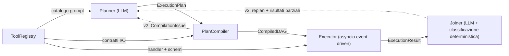

# langgraph-llm-compiler

Implementazione modulare dell'architettura **LLM Compiler** con orchestrazione tramite **LangGraph** e supporto a modelli locali via **Ollama** (testata con `qwen3:8b`).

Il progetto è progettato con tre obiettivi primari: **correttezza formale**, **riproducibilità** e **valutazione sperimentale comparativa** (latenza, parallelismo effettivo, speedup rispetto a baseline sequenziali, affidabilità e confronti tra framework/architetture).

---

## Architettura

La pipeline separa rigorosamente pianificazione, validazione/compilazione, esecuzione concorrente, sintesi e orchestrazione del workflow:



### Stato dei moduli

| Modulo | Stato | Responsabilità |
| :--- | :--- | :--- |
| `planner` | Implementato | Genera un `ExecutionPlan` tipizzato via structured output (`json_schema`), con `BaseChatModel` iniettato e `PlannerOutputError` con `raw_output`. |
| `compiler` | Implementato | `ToolRegistry` (unica *source of truth*), validazione semantica in singola passata (6 regole) e costruzione di un `CompiledDAG` read-only. |
| `executor` | Implementato | Scheduler `asyncio` event-driven con `ready_queue`, risoluzione `input_bindings`/`output_path`, validazione runtime I/O, timeout, gestione best-effort + `skipped` e telemetria per task. |
| `joiner` | Implementato (v1) | Sintesi della risposta finale nella lingua della richiesta utente originale (`JoinerOutput`), con classificazione deterministica di `status` (`complete`/`partial`/`failed`) e `missing_information` (`JoinerResult`). |
| `graph` | Implementato (v1) | `StateGraph` LangGraph lineare con uscite condizionali su errore (`planner`, `compiler`, `executor`), stato `CompilerState`, `WorkflowError` e `WorkflowMetrics` (`component_latency_ms`). |

---

## Scelte architetturali e motivazioni

### 1. Parametri unificati (`inputs`) e dipendenze implicite tramite `InputBinding`
In `planner/schemas.py`, `TaskSpec` utilizza un **singolo dizionario `inputs: dict[str, InputBinding | Any]`** (`union_mode="left_to_right"`) in cui ogni parametro contiene o un valore statico oppure un riferimento `InputBinding(task_id, output_path)` — vietando campi separati `arguments`, `input_bindings` e `dependencies` (`extra="forbid"`).
* Il DAG viene derivato direttamente dai binding (`task.bindings`), eliminando divergenze tra dipendenze dichiarate e dati consumati.
* Unificare valori statici e binding nello stesso dizionario rende **strutturalmente impossibile per costruzione** la collisione di chiavi tra parametri statici e dinamici (errore molto frequente sui modelli locali 8B quando si separano `arguments` e `input_bindings`).

### 2. Separazione tra validazione sintattica (Pydantic) e semantica (`PlanCompiler`)
Gli schemi Pydantic in `planner/schemas.py` verificano solo la struttura locale dei modelli (`frozen=True`, `extra="forbid"`, `NonEmptyStr`). Tutti gli invarianti globali vengono verificati da `PlanCompiler` in **un'unica passata**, raccogliendo tutte le `CompilationIssue` in una `PlanCompilationError`:
1. Unicità dei `task_id` (`duplicate_task_id`).
2. Esistenza di ogni `tool_name` nel `ToolRegistry` (`unknown_tool`).
3. Esistenza dei task referenziati ed esclusione di auto-dipendenze (`missing_dependency`, `self_dependency`).
4. Assenza di cicli con ricostruzione del percorso (`cycle_detected`) e calcolo di ordine topologico e livelli paralleli (algoritmo di Kahn).
5. Validazione statica di `input_schema` (parametri mancanti, sconosciuti, valori statici non validi) e di `output_path` su `output_schema`.

Questa separazione distingue nettamente errori di parsing JSON da errori semantici di compilazione e consente di inviare feedback strutturato al `Planner` nel futuro loop di self-correction.

### 3. `ToolRegistry` come unica *source of truth*
Ogni strumento è descritto una sola volta tramite `ToolSpec(name, description, func, input_schema, output_schema)`:
* `ToolRegistry.to_planner_catalog()` genera automaticamente il catalogo testuale per il prompt del `Planner`.
* `PlanCompiler` usa gli stessi schemi per validare parametri e `output_path` prima dell'esecuzione.
* `Executor` usa gli stessi schemi per la validazione runtime prima e dopo l'invocazione del tool.

### 4. Scheduler event-driven in `asyncio` (e perché il DAG non è un `StateGraph` dinamico)
L'`Executor` è completamente indipendente da LangGraph ed esegue il `CompiledDAG` con uno scheduler **event-driven / ready-queue** (`asyncio.create_task` + `asyncio.wait(..., return_when=FIRST_COMPLETED)` + `dag.is_ready()`):
* **Nessuna barriera wave-based / BSP**: il runtime Pregel di LangGraph avanza per superstep sincroni (modello *Bulk Synchronous Parallel*), costringendo tutti i nodi del superstep corrente a terminare prima di avviare il successivo. Su un DAG asimmetrico (es. ramo A `0.1s -> 2.5s`, ramo B `3.0s -> 0.1s`, join `0.1s`), uno scheduler BSP impiega `5.6s`, mentre il nostro scheduler event-driven completa in `3.2s` perché avvia i figli del ramo veloce non appena il predecessore termina.
* **Concorrenza controllata (`max_concurrency`)**: default `8`, `None` per concorrenza illimitata, `1` come **baseline sequenziale deterministico** sullo stesso `Executor` (a parità di overhead).
* **Tool sync e async**: `async def` invocati con `await`, `def` sincroni eseguiti via `asyncio.to_thread()` per non bloccare l'event loop.
* **Timeout configurabili (`task_timeout_s`)**: su tool `async def` annullano la coroutine via `asyncio.wait_for`; su tool sincroni in `asyncio.to_thread` interrompono l'attesa registrando un errore di timeout (in Python un thread OS già avviato non può essere terminato forzatamente, quindi è bene evitare tool sincroni con side-effect non idempotenti nei test di timeout).

### 5. Gestione errori best-effort, propagazione `SKIPPED` e telemetria
In caso di errore di un task, l'`Executor` **non interrompe** i rami indipendenti:
* Il task fallito registra `status="error"`, `error_type`, `error` e `error_stage` (`binding`, `input_validation`, `tool_execution`, `output_validation`, `timeout`), distinguendo errori di binding, validazione runtime, timeout ed eccezioni del tool.
* Tutti i discendenti raggiungibili vengono marcati immediatamente `status="skipped"` (propagazione transitiva) con `started_at_ms=None`, `finished_at_ms=None` e `skip_reason`.
* Tutti i risultati (`TaskExecutionResult`, `ExecutionResult`) sono modelli Pydantic `frozen=True` privi di oggetti `Exception` raw, quindi direttamente serializzabili per lo stato di LangGraph e i report sperimentali.

### 6. Separazione deterministica nel `Joiner` (`JoinerOutput` vs `JoinerResult`)
Nel `Joiner` l'LLM genera solo `JoinerOutput(answer)` (nella lingua della richiesta utente originale, strettamente ancorato agli output `success`). Lo stato di completezza (`complete` / `partial` / `failed`) e `missing_information` (in ordine topologico, usando `task.description` o `tool_name` come fallback) sono calcolati **deterministicamente** dal codice a partire da `ExecutionResult` e impacchettati in `JoinerResult`.

### 7. Ruolo di LangGraph
LangGraph viene riservato al livello di **orchestrazione macro stateful** (`graph/`):
* gestione dei cicli di controllo (`planner <-> compiler` in v2, `joiner -> planner` in v3) tramite conditional edges e stato tipizzato;
* streaming, checkpointing e ispezionabilità passo-passo;
* interfaccia uniforme (`ainvoke`/`astream`) per il confronto sperimentale *apples-to-apples* con altre architetture (es. ReAct).

### 8. Rigore metodologico sulle metriche
Per evitare ambiguità nei benchmark, teniamo distinte due metriche:
* **Effective parallelism**: $\sum_i T_i / T_{\text{parallel}}$ (parallelismo medio osservato durante una singola esecuzione).
* **Measured speedup**: $T_{\text{sequential}} / T_{\text{parallel}}$ (misurato rieseguendo lo stesso `CompiledDAG` con `max_concurrency=1` come baseline sequenziale).

---

## Struttura del repository

```text
langgraph-llm-compiler/
├── pyproject.toml
├── src/
│   └── langgraph_llm_compiler/
│       ├── llm.py                 # Factory ChatOllama
│       ├── planner/
│       │   ├── schemas.py         # InputBinding, TaskSpec, ExecutionPlan
│       │   └── planner.py         # Planner (plan / aplan), SYSTEM_PROMPT, PlannerOutputError
│       ├── compiler/
│       │   ├── registry.py        # ToolSpec, ToolRegistry
│       │   ├── dag.py             # CompilationIssue, PlanCompilationError, CompiledDAG
│       │   └── compiler.py        # PlanCompiler (validazione + Kahn scheduling)
│       ├── executor/
│       │   ├── results.py         # TaskExecutionResult, ExecutionResult
│       │   ├── bindings.py        # resolve_output_path, resolve_task_inputs
│       │   └── executor.py        # Executor (scheduler event-driven async)
│       ├── joiner/
│       │   ├── schemas.py         # JoinerOutput, JoinerResult, JoinerStatus
│       │   └── joiner.py          # Joiner (async join), classificazione deterministica, JoinerOutputError
│       └── graph/
│           ├── state.py           # CompilerState, WorkflowError, WorkflowMetrics, update_metrics
│           ├── nodes.py           # 4 nodi async sottili (planner, compiler, executor, joiner)
│           └── builder.py         # build_compiler_graph() -> CompiledStateGraph
├── tests/
│   ├── test_planner_schemas.py
│   ├── test_planner.py
│   ├── test_compiler.py
│   ├── test_executor.py
│   ├── test_joiner.py
│   └── test_graph.py
├── experiments/
│   ├── test_planner_qwen3.py      # Pipeline diretta Python (Registry -> Planner -> Compiler -> Executor -> Joiner)
│   ├── test_graph_qwen3.py        # Esperimento A (live LangGraph vs Direct) + Esperimento B (overhead isolato)
│   └── test2.py                   # Stress test multi-scenario (DAG asimmetrici, fan-out, fallimento parziale)
└── results/                       # Output sperimentali e benchmark
```

---

## Setup e comandi

Requisiti: Python `>=3.12`, [`uv`](https://docs.astral.sh/uv/) e [Ollama](https://ollama.com/) (solo per gli esperimenti live con modelli locali).

```bash
# Installa le dipendenze (inclusi pytest e ruff)
uv sync

# Esegui la suite di test unitari (non richiede Ollama)
uv run pytest -v

# Controllo lint con ruff
uv run ruff check src tests experiments
```

### Esperimento end-to-end con `qwen3:8b`

Assicurati che Ollama sia attivo con il modello `qwen3:8b` disponibile (`ollama pull qwen3:8b`), poi esegui:

```bash
uv run python experiments/test_planner_qwen3.py
```

Lo script esegue l'intera pipeline (`ToolRegistry -> Planner -> PlanCompiler -> Executor -> Joiner`), confronta il run parallelo (`max_concurrency=8`) con il baseline sequenziale (`max_concurrency=1`) sullo stesso `CompiledDAG` e stampa timeline ASCII, risposta finale e riepilogo metriche.

---

## Roadmap

- [x] **Planner**: schemi Pydantic, structured output, prompt 1-shot, test unitari.
- [x] **Compiler**: `ToolRegistry`, validazione semantica in singola passata, `CompiledDAG`, test unitari.
- [x] **Executor**: scheduler event-driven, binding resolution, validazione runtime I/O, best-effort + `skipped`, timeout, test unitari.
- [x] **Joiner v1**: sintesi risposta finale nella lingua dell'utente (`JoinerOutput`), stato e `missing_information` deterministici (`JoinerResult`), test unitari.
- [x] **LangGraph v1**: `StateGraph` lineare con uscite condizionali su errore (`planner`, `compiler`, `executor`), `WorkflowMetrics`, test unitari (`test_graph.py`) ed esperimenti comparativi (`test_graph_qwen3.py`).
- [ ] **v2 — Compile-time self-correction**: ciclo `compiler -> planner` con `CompilationIssue` e budget di retry.
- [ ] **v3 — Runtime replanning**: ciclo `joiner -> planner` con risultati parziali e `max_replans`.
- [ ] **Esperimenti & Benchmark**: suite riproducibile in `experiments/` e `results/` (parallelismo, latenza, affidabilità, confronto con ReAct e altri framework).
