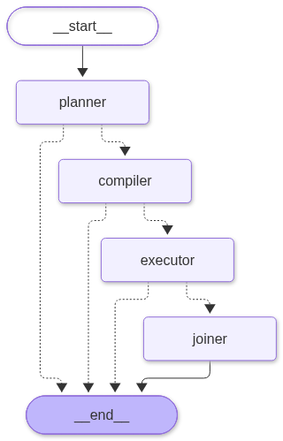
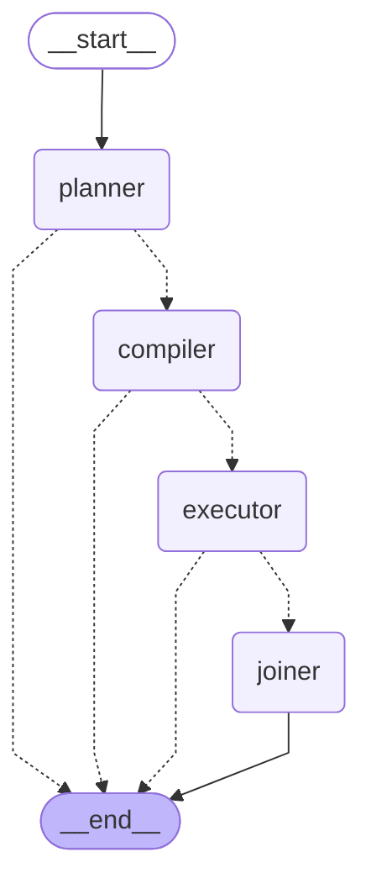
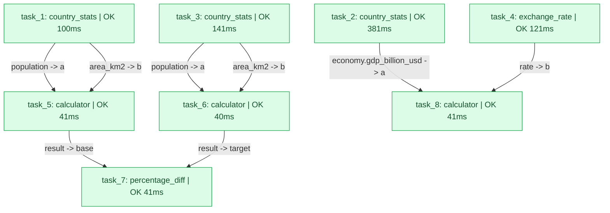
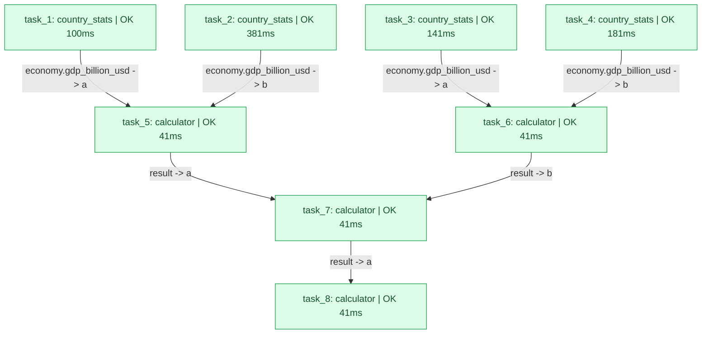
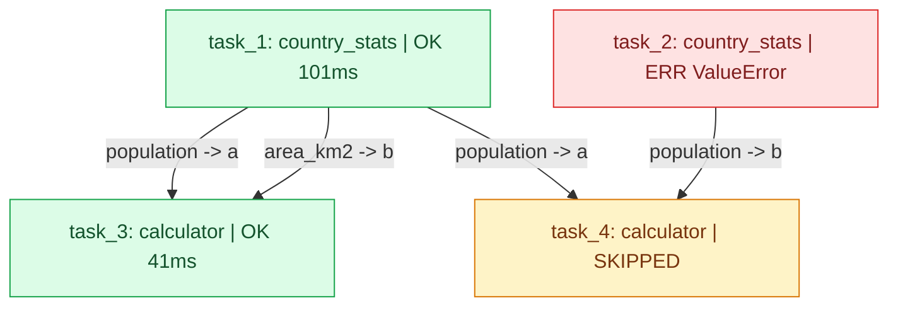

# LangGraph LLM Compiler Trace (`all`)

- **Model**: `qwen3:8b` (`planner reasoning=False`, `joiner reasoning=False`)
- **Scenarios**: 3

## LangGraph StateGraph

## Scenario: `multi_branch_diamond` — Asymmetric multi-branch DAG + nested outputs

> **User Request:** Fetch statistics for Italy, France, and Germany, and get the USD to EUR exchange rate. Then: (1) compute the population density (population divided by area_km2) for Italy and Germany; (2) compute the percentage change of Germany's density (target) relative to Italy's density (base); (3) convert France's GDP in billion USD into billion EUR by multiplying it by the USD->EUR rate.

- **LangGraph path**: `START → planner → compiler → executor → joiner → END`
- **Timings**: Plan `10.63s` | Compile `0.52ms` | Exec `421.8ms` (seq `906.3ms`, speedup **`2.15x`**) | Join `1.72s` | Overhead `5.30ms`
- **Status**: `complete` | **LLM calls**: `2`

### Compiled DAG

### Task Execution Details

| Task | Tool | Status | Window (ms) | Duration | Result / Error |
| :--- | :--- | :---: | :---: | ---: | :--- |
| `task_1` | `country_stats` | `success` | 0 -> 101 | 100.5 ms | Italy: pop=58,990,000 \| area=301,340 km² \| GDP=$2,300B \| unemp=6.8% |
| `task_2` | `country_stats` | `success` | 0 -> 381 | 381.0 ms | France: pop=68,400,000 \| area=551,695 km² \| GDP=$3,130B \| unemp=7.4% |
| `task_3` | `country_stats` | `success` | 0 -> 141 | 141.2 ms | Germany: pop=83,500,000 \| area=357,588 km² \| GDP=$4,525B \| unemp=3.4% |
| `task_4` | `exchange_rate` | `success` | 0 -> 121 | 120.9 ms | USD/EUR = 0.92 |
| `task_5` | `calculator` | `success` | 101 -> 141 | 40.6 ms | result = 195.76 |
| `task_6` | `calculator` | `success` | 141 -> 182 | 40.5 ms | result = 233.51 |
| `task_8` | `calculator` | `success` | 381 -> 422 | 40.5 ms | result = 2,879.60 |
| `task_7` | `percentage_diff` | `success` | 182 -> 223 | 40.6 ms | delta = +37.75 (+19.28%) |

### Final Answer

Here are the results of the requested calculations:

1. Population density for Italy is approximately 195.76 people per km², and for Germany it is approximately 233.51 people per km².
2. The percentage change of Germany's population density relative to Italy's is approximately 19.28%.
3. France's GDP, which is $3,130 billion in USD, is equivalent to approximately €2,879.6 billion when converted using the USD to EUR exchange rate of 0.92.

## Scenario: `wide_fanout_tree` — Wide fan-out (4 countries) + 4-level reduction tree

> **User Request:** Fetch statistics for Italy, France, Germany, and Spain. Compute the sum of GDP (gdp_billion_usd) of Italy and France, the sum of GDP of Germany and Spain, then add the two partial sums to get the combined GDP of all 4 countries, and finally divide the total by the static number 4 to compute the average GDP.

- **LangGraph path**: `START → planner → compiler → executor → joiner → END`
- **Timings**: Plan `6.76s` | Compile `0.51ms` | Exec `503.8ms` (seq `967.5ms`, speedup **`1.92x`**) | Join `0.64s` | Overhead `5.37ms`
- **Status**: `complete` | **LLM calls**: `2`

### Compiled DAG

### Task Execution Details

| Task | Tool | Status | Window (ms) | Duration | Result / Error |
| :--- | :--- | :---: | :---: | ---: | :--- |
| `task_1` | `country_stats` | `success` | 0 -> 100 | 100.4 ms | Italy: pop=58,990,000 \| area=301,340 km² \| GDP=$2,300B \| unemp=6.8% |
| `task_2` | `country_stats` | `success` | 0 -> 381 | 380.9 ms | France: pop=68,400,000 \| area=551,695 km² \| GDP=$3,130B \| unemp=7.4% |
| `task_3` | `country_stats` | `success` | 0 -> 141 | 140.9 ms | Germany: pop=83,500,000 \| area=357,588 km² \| GDP=$4,525B \| unemp=3.4% |
| `task_4` | `country_stats` | `success` | 0 -> 181 | 181.3 ms | Spain: pop=48,800,000 \| area=505,990 km² \| GDP=$1,650B \| unemp=11.3% |
| `task_5` | `calculator` | `success` | 381 -> 422 | 40.7 ms | result = 5,430.00 |
| `task_6` | `calculator` | `success` | 182 -> 222 | 41.0 ms | result = 6,175.00 |
| `task_7` | `calculator` | `success` | 422 -> 463 | 40.7 ms | result = 11,605.00 |
| `task_8` | `calculator` | `success` | 463 -> 504 | 41.0 ms | result = 2,901.25 |

### Final Answer

The average GDP of Italy, France, Germany, and Spain is 2901.25 billion USD.

## Scenario: `partial_failure_recovery` — Partial failure + transitive skip + transparent Joiner

> **User Request:** Fetch statistics for Italy and Atlantis. Compute Italy's population density (population divided by area_km2) and compute the difference between Italy's population and Atlantis's population (Italy minus Atlantis).

- **LangGraph path**: `START → planner → compiler → executor → joiner → END`
- **Timings**: Plan `3.50s` | Compile `0.35ms` | Exec `141.6ms` (seq `192.4ms`, speedup **`1.36x`**) | Join `0.80s` | Overhead `4.84ms`
- **Status**: `partial` | **LLM calls**: `2`

### Compiled DAG

### Task Execution Details

| Task | Tool | Status | Window (ms) | Duration | Result / Error |
| :--- | :--- | :---: | :---: | ---: | :--- |
| `task_1` | `country_stats` | `success` | 0 -> 101 | 100.9 ms | Italy: pop=58,990,000 \| area=301,340 km² \| GDP=$2,300B \| unemp=6.8% |
| `task_2` | `country_stats` | `error` | 0 -> 51 | 50.5 ms | ValueError: Country 'Atlantis' not found in dataset. |
| `task_3` | `calculator` | `success` | 101 -> 142 | 40.5 ms | result = 195.76 |
| `task_4` | `calculator` | `skipped` | skipped | 0.0 ms | Skipped because upstream task 'task_2' failed. |

### Final Answer

The population density of Italy is approximately 195.76 people per square kilometer. However, the population difference between Italy and Atlantis could not be calculated because the demographic and economic statistics for Atlantis were not found in the dataset.
