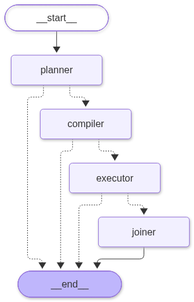
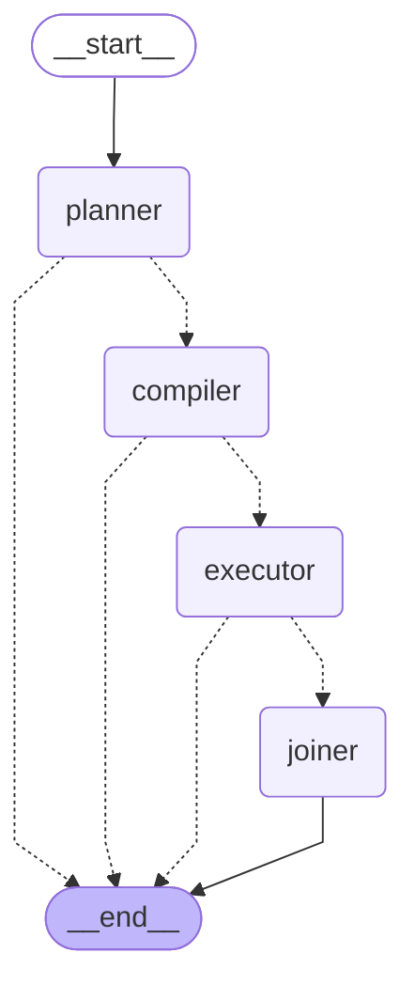
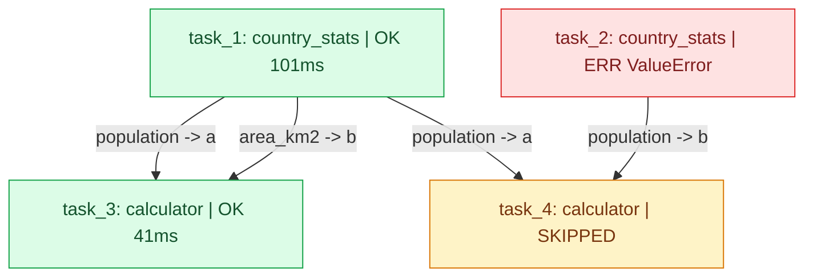

# LangGraph LLM Compiler Trace (`partial_failure_recovery`)

- **Model**: `qwen3:8b` (`planner reasoning=False`, `joiner reasoning=False`)
- **Scenarios**: 1

## LangGraph StateGraph

## Scenario: `partial_failure_recovery` — Partial failure + transitive skip + transparent Joiner

> **User Request:** Fetch statistics for Italy and Atlantis. Compute Italy's population density (population divided by area_km2) and compute the difference between Italy's population and Atlantis's population (Italy minus Atlantis).

- **LangGraph path**: `START → planner → compiler → executor → joiner → END`
- **Timings**: Plan `3.78s` | Compile `0.38ms` | Exec `141.9ms` (seq `191.7ms`, speedup **`1.35x`**) | Join `0.77s` | Overhead `5.50ms`
- **Status**: `partial` | **LLM calls**: `2`

### Compiled DAG

### Task Execution Details

| Task | Tool | Status | Window (ms) | Duration | Result / Error |
| :--- | :--- | :---: | :---: | ---: | :--- |
| `task_1` | `country_stats` | `success` | 0 -> 101 | 100.9 ms | Italy: pop=58,990,000 \| area=301,340 km² \| GDP=$2,300B \| unemp=6.8% |
| `task_2` | `country_stats` | `error` | 0 -> 51 | 50.2 ms | ValueError: Country 'Atlantis' not found in dataset. |
| `task_3` | `calculator` | `success` | 101 -> 142 | 40.7 ms | result = 195.76 |
| `task_4` | `calculator` | `skipped` | skipped | 0.0 ms | Skipped because upstream task 'task_2' failed. |

### Final Answer

The population density of Italy is approximately 195.76 people per square kilometer. However, the population difference between Italy and Atlantis could not be calculated because the demographic and economic statistics for Atlantis were not found in the dataset.
